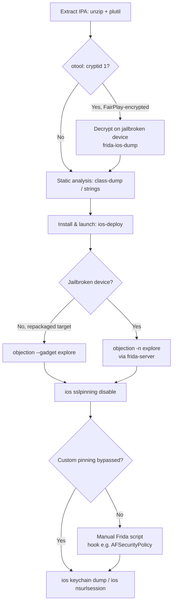

#mobile #ios #frida #objection #ipa

# iOS Application Testing

Related: [static-analysis](static-analysis.md) · [dynamic-analysis](dynamic-analysis.md) · [automation](automation.md)

## Contents
- [Getting the IPA](#getting-the-ipa)
- [Static Analysis](#static-analysis)
- [Dynamic Analysis — Frida / Objection (Jailbroken or Rooted-equivalent Device)](#dynamic-analysis--frida--objection-jailbroken-or-rooted-equivalent-device)
- [Manual Frida Scripting (Custom Pinning / Jailbreak Detection)](#manual-frida-scripting-custom-pinning--jailbreak-detection)
- [Common iOS-Specific Findings](#common-ios-specific-findings)

End-to-end workflow this note walks through, from IPA to Keychain dump:



## Getting the IPA
```bash
unzip app.ipa -d app_extracted
plutil -convert xml1 app_extracted/Payload/App.app/Info.plist -o Info.xml
```
An IPA is just a zip; `Payload/<App>.app/` holds the binary, `Info.plist` (convert to readable XML), and bundled resources/entitlements.

```bash
otool -L app_extracted/Payload/App.app/App
otool -l app_extracted/Payload/App.app/App | grep -A5 LC_ENCRYPTION_INFO
```
List linked libraries, and check if the binary is still App-Store-encrypted (`cryptid 1`) — a FairPlay-encrypted binary needs decrypting (on a jailbroken device, e.g. via `frida-ios-dump`) before static analysis of the actual code.

> [!IMPORTANT]
> `cryptid 1` means the binary is still FairPlay-encrypted — `class-dump`, `strings`, Ghidra, etc. will only see garbage until it's decrypted on a jailbroken device.

## Static Analysis
```bash
class-dump -H app_extracted/Payload/App.app/App -o headers/
```
Recover Objective-C class/method headers from the binary (Swift-only binaries need `swift-demangle`/Hopper/Ghidra instead — class-dump doesn't resolve Swift metadata the same way).

```bash
grep -r "NSURLSession\|AFNetworking\|kSecAttrAccount\|NSLog" headers/ 2>/dev/null
strings App | grep -iE "http://|api[_-]?key|secret"
```
Hunt for hardcoded endpoints/keys and networking stack hints in headers and raw strings.

## Dynamic Analysis — Frida / Objection (Jailbroken or Rooted-equivalent Device)
```bash
ios-deploy -b app_extracted/Payload/App.app --debug
```
Install and launch the app on a connected device for testing.

```bash
objection --gadget "com.target.app" explore
objection -n "App" explore
```
Attach via the Frida gadget (for a repackaged/non-jailbroken target) or by process name on a jailbroken device with frida-server running.

```text
ios sslpinning disable
```
Disables common SSL-pinning implementations (AFNetworking, custom NSURLSessionDelegate checks) at runtime so Burp/mitmproxy can intercept TLS traffic — doesn't cover bespoke pinning logic, which needs a manual Frida script instead.

```text
ios keychain dump
ios keychain dump --json loot.json
```
Dump Keychain items accessible to the app's own access group.

> [!NOTE]
> This is scoped to the app's own Keychain access group, not the system-wide Keychain — dumping other apps' entries needs jailbreak-level tooling outside Objection's scope.

```text
ios nsurlsession
android ... # n/a - iOS equivalent commands only
```

> [!NOTE]
> All Objection changes are runtime-only and reset when the app restarts — nothing here persists a patch to disk.

## Manual Frida Scripting (Custom Pinning / Jailbreak Detection)
```javascript
if (ObjC.available) {
  var className = "AFSecurityPolicy";
  var methodName = "- setSSLPinningMode:";
  var hook = ObjC.classes[className][methodName];
  Interceptor.attach(hook.implementation, {
    onEnter: function(args) {
      // args[2] is the pinning mode selector argument; force AFSSLPinningModeNone (0)
      args[2] = ptr(0);
    }
  });
}
```
```bash
frida -U -l bypass.js -f com.target.app --no-pause
```
Spawn the app with a custom Objective-C hook when `ios sslpinning disable`'s built-in bypasses don't cover the app's specific implementation.

## Common iOS-Specific Findings
- `NSAllowsArbitraryLoads` / overly-broad ATS exceptions in `Info.plist` — allows plaintext or weakly-validated HTTP
- Secrets/API keys embedded in the binary (`strings`) rather than fetched at runtime
- `UIPasteboard` leaking sensitive data to other apps (general pasteboard is readable by any app on older iOS versions)
- Keychain items stored with an overly-permissive `kSecAttrAccessible` (e.g. `...AlwaysThisDeviceOnly` missing, allowing backup extraction)
- Local data (SQLite DBs, plist files, cache) left unencrypted under `Documents`/`Library` — check with [static-analysis](static-analysis.md)'s filesystem-dump approach, same idea as the Android side.
