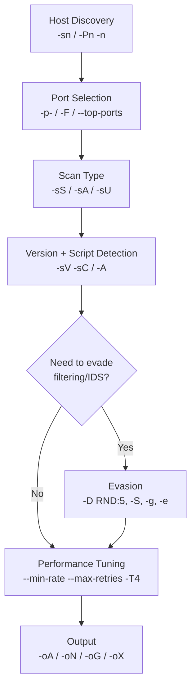

#network #nmap #enumeration #scanning

# Network Enumeration with Nmap

Related: [footprinting](footprinting.md) · [common-services](common-services.md) · [web-recon](../Web/web-recon.md)

## Contents
- [Host Discovery](#host-discovery)
- [Port Selection](#port-selection)
- [Scan Types](#scan-types)
- [Evasion](#evasion)
- [Performance](#performance)
- [Output](#output)
- [Typical Workflow](#typical-workflow)
- [Flag Reference](#flag-reference)

## Typical Workflow



## Host Discovery
```bash
nmap -sn 10.10.10.0/24 --disable-arp-ping
```
Ping sweep only (no port scan).

```bash
nmap -Pn -n 10.10.10.0/24
```
Skip host discovery (`-Pn`) and DNS resolution (`-n`).

## Port Selection
```bash
nmap -p- 10.10.10.10
```
Scan all 65535 ports (`-F` = top 100, `--top-ports=<n>`, `-p22,25` = specific).

## Scan Types
```bash
nmap -sS 10.10.10.10
```
TCP SYN scan (`-sA` ACK, `-sU` UDP).

```bash
nmap -sV -sC 10.10.10.10
```
Version detection + default scripts.

```bash
nmap -A 10.10.10.10
```
OS detection, version detection, scripts, traceroute.

```bash
nmap --script <script> 10.10.10.10
```
Run specific NSE scripts.

## Evasion
```bash
nmap -D RND:5 10.10.10.10
```
Scan with 5 random decoys (`-S <ip>` spoof source, `-g <port>` source port, `-e <iface>`).

## Performance
```bash
nmap --min-rate 300 --max-retries 1 -T4 10.10.10.10
```
Tune speed (packet rate, retries, timing template 0-5).

```bash
nmap --packet-trace --reason 10.10.10.10
```
Show packets sent/received and the reason for each result.

## Output
```bash
nmap -A 10.10.10.10 -oA scan_results
```
Save in all formats (`-oN` normal, `-oG` grepable, `-oX` XML).

## Flag Reference

| Flag | Meaning |
|---|---|
| `-sn` | Ping sweep only, no port scan |
| `-Pn` | Skip host discovery |
| `-n` | Skip DNS resolution |
| `-p-` | Scan all 65535 ports |
| `-F` | Top 100 ports |
| `--top-ports=<n>` | Top `<n>` most common ports |
| `-p22,25` | Specific port list |
| `-sS` | TCP SYN scan |
| `-sA` | TCP ACK scan |
| `-sU` | UDP scan |
| `-sV` | Version detection |
| `-sC` | Default NSE scripts |
| `-A` | OS detection + version + scripts + traceroute |
| `--script <script>` | Run specific NSE script(s) |
| `-D RND:5` | 5 random decoys |
| `-S <ip>` | Spoof source IP |
| `-g <port>` | Spoof source port |
| `-e <iface>` | Use specific interface |
| `--min-rate <n>` | Minimum packet send rate |
| `--max-retries <n>` | Cap retransmissions |
| `-T0`–`-T5` | Timing template (slowest–fastest) |
| `--packet-trace` | Show packets sent/received |
| `--reason` | Show reason for each result |
| `-oA <basename>` | Save in all formats |
| `-oN` | Normal output |
| `-oG` | Grepable output |
| `-oX` | XML output |
