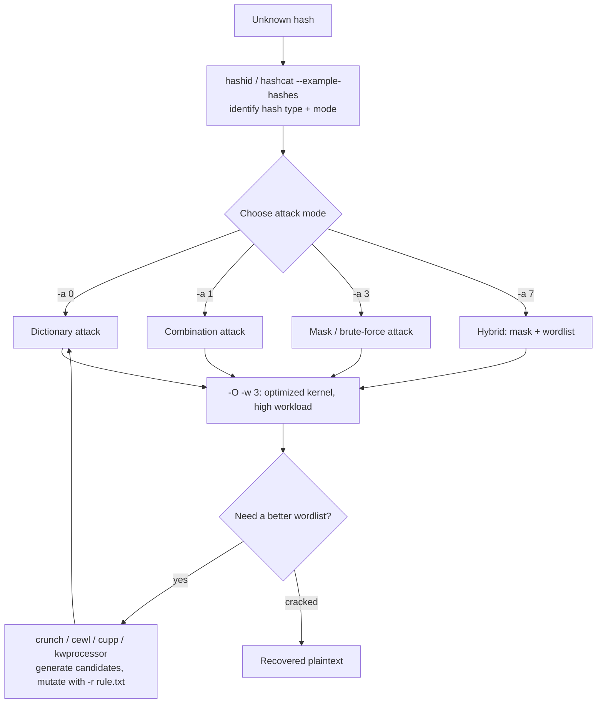

#passwords #hashcat #cracking #wordlists

# Cracking Passwords with Hashcat

Related: [password-attacks](password-attacks.md) · [login-brute-forcing](login-brute-forcing.md) · [kerberoasting](../AD/kerberoasting.md) · [password-cracking](../WiFi/password-cracking.md)

## Contents
- [Identify & Benchmark](#identify--benchmark)
- [Attack Modes](#attack-modes)
- [Optimization](#optimization)
- [Wordlist Generation](#wordlist-generation)
- [Mask-Based Rule Generation](#mask-based-rule-generation)
- [WiFi Capture Conversion](#wifi-capture-conversion)

The sections below follow the typical cracking workflow: identify the hash, pick an attack mode, optimize the run, and feed it a better wordlist when needed.



## Identify & Benchmark
```bash
hashid <hash>
```
Identify a hash type (`pip install hashid`).

```bash
hashcat --example-hashes
```
List hash modes with examples (`-b -m <mode>` to benchmark one).

## Attack Modes

| `-a` Mode | Attack Type | Example |
|---|---|---|
| 0 | Dictionary | `hashcat -a 0 -m <mode> <hash file> <wordlist>` |
| 1 | Combination | `hashcat -a 1 -m <mode> <hash file> <wordlist1> <wordlist2>` |
| 3 | Mask (brute-force) | `hashcat -a 3 -m 0 <hash file> -1 01 'ILFREIGHT?l?l?l?l?l20?1?d'` |
| 7 | Hybrid (mask + wordlist) | `hashcat -a 7 -m 0 <hash file> -1=01 '20?1?d' rockyou.txt` |
| 0 + `-r` | Dictionary with mutation rules | `hashcat -a 0 -m 100 hash rockyou.txt -r rule.txt` |

```bash
hashcat -a 0 -m <mode> <hash file> <wordlist>
```
Dictionary attack.

```bash
hashcat -a 1 -m <mode> <hash file> <wordlist1> <wordlist2>
```
Combination attack.

```bash
hashcat -a 3 -m 0 <hash file> -1 01 'ILFREIGHT?l?l?l?l?l20?1?d'
```
Mask (brute-force) attack with a custom charset.

```bash
hashcat -a 7 -m 0 <hash file> -1=01 '20?1?d' rockyou.txt
```
Hybrid attack (mask + wordlist).

```bash
hashcat -a 0 -m 100 hash rockyou.txt -r rule.txt
```
Dictionary attack with a mutation rule file.

## Optimization
```bash
hashcat -O -w 3 -a 0 -m <mode> <hash file> <wordlist>
```
Optimized kernel + high workload (`-w 3`).[^1]

[^1]: `-O` enables the optimized kernels (faster), but caps the maximum crackable password length — drop it if you need to crack long passwords/passphrases.

## Wordlist Generation

| Tool | Purpose | Example |
|---|---|---|
| crunch | Generate a charset/pattern-based wordlist | `crunch <min> <max> <charset> -t <pattern> -o wordlist.txt` |
| cewl | Scrape a website's keywords into a wordlist | `cewl -d 4 -m 6 --lowercase -w inlane.wordlist https://www.inlanefreight.com` |
| cupp | Build a personalized wordlist interactively | `python3 cupp.py -i` |
| kwprocessor (kwp) | Generate keyboard-walk passwords | `kwp -s 1 basechars/full.base keymaps/en-us.keymap routes/2-to-10-max-3-direction-changes.route` |

```bash
crunch <min> <max> <charset> -t <pattern> -o wordlist.txt
```
Generate a wordlist with Crunch.

```bash
cewl -d 4 -m 6 --lowercase -w inlane.wordlist https://www.inlanefreight.com
```
Scrape keywords from a website into a wordlist.

```bash
python3 cupp.py -i
```
Build a personalized wordlist interactively (CUPP).

```bash
kwp -s 1 basechars/full.base keymaps/en-us.keymap routes/2-to-10-max-3-direction-changes.route
```
Generate keyboard-walk passwords (kwprocessor).

## Mask-Based Rule Generation
```bash
hashcat -r custom.rule password.list --stdout > mut_password.list
```
Apply rules to a wordlist and write mutations.

## WiFi Capture Conversion
```bash
hcxpcapngtool -o pmkidhash_corp cracking_pmkid.cap
```
Convert a capture to a crackable PMKID/handshake hash.
