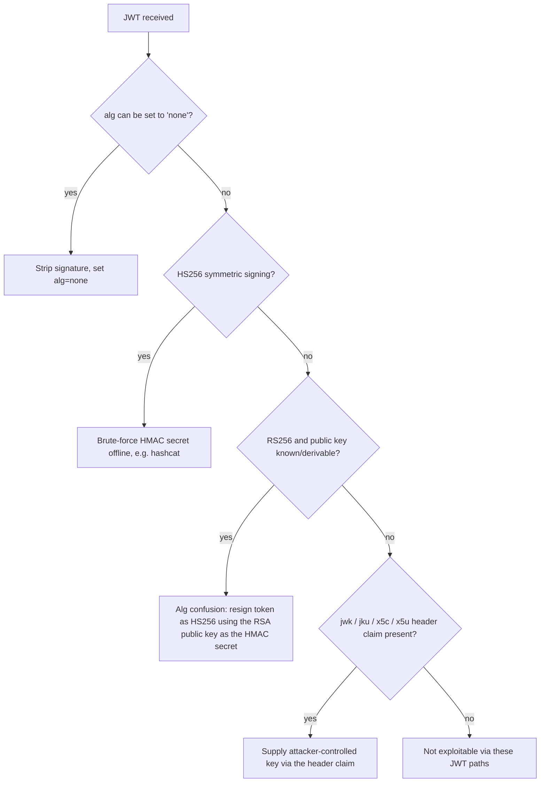
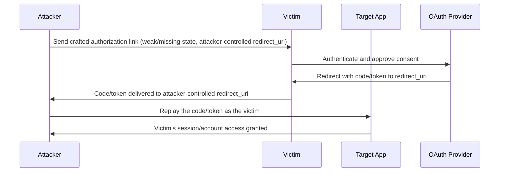

#web #authentication #jwt #oauth #saml

# Attacking Authentication

Broken auth + JWT/OAuth/SAML. Related: [login-brute-forcing](../Passwords/login-brute-forcing.md) · [injection-attacks](injection-attacks.md) · [csrf-cors-csp](csrf-cors-csp.md)

## Contents
- [Brute-Force Protection Bypass](#brute-force-protection-bypass)
- [Weak Points to Test](#weak-points-to-test)
- [Session Attacks](#session-attacks)
- [JWT](#jwt)
- [OAuth](#oauth)
- [SAML](#saml)

## Brute-Force Protection Bypass
```http
X-Forwarded-For: 1.2.3.4
```
Rotate this header to bypass IP-based rate limiting.

```text
CAPTCHA: check the HTML for the solution/answer leaked client-side
```
Common CAPTCHA weakness.

## Weak Points to Test
Broken-authentication checklist:
- [ ] Default credentials (CIRT.net, SecLists default-credentials, SCADA lists)
- [ ] Vulnerable password reset (guessable security questions, username injection in reset request)
- [ ] Brute-forceable password-reset / 2FA tokens
- [ ] Direct access to protected pages / HTTP parameter manipulation

## Session Attacks
Session-handling weaknesses:
- [ ] Brute-force cookies with insufficient entropy
- [ ] Session fixation (force victim onto an attacker-known session id)
- [ ] Improper session timeout

## JWT
JWT attack checklist. See [hashcat](../Passwords/hashcat.md) for cracking the secret.
- [ ] Remove the signature / set alg to "none"
- [ ] Brute-force the HMAC secret (symmetric)
- [ ] Algorithm confusion (RS256 -> HS256 using the public key)
- [ ] Abuse header claims: jwk, jku, x5c, x5u


Decision tree over the checklist above.

## OAuth
OAuth misconfiguration checklist. See [xss](xss.md).
- [ ] Is redirect_uri properly validated?
- [ ] Is a state parameter present and validated (CSRF)?
- [ ] Reflected OAuth parameters -> XSS


Exploit flow when `redirect_uri` and/or `state` validation is missing.

## SAML
SAML attack checklist. See [server-side-attacks](server-side-attacks.md).
- [ ] Remove the signature from the SAML response
- [ ] Signature Wrapping (XSW)
- [ ] XXE / XSLT injection in the SAML XML
