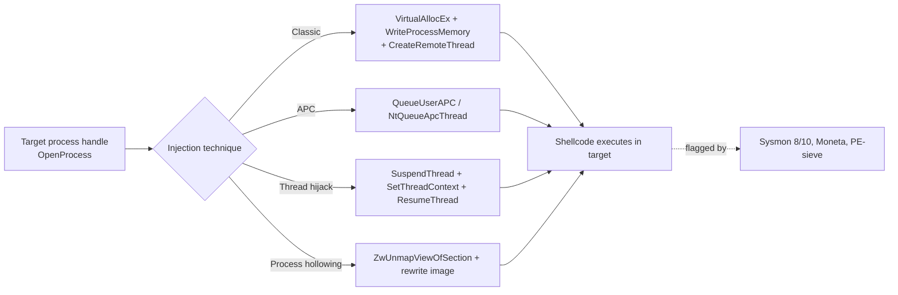

#windows #process-injection #malware #windbg

# Process Injection: Attacks & Detection

Related: [windbg](../Reversing/windbg.md) · [low-level-detectability](low-level-detectability.md) · [kernel-telemetry](../Detection/kernel-telemetry.md)

## Contents
- [Shellcode / Payload Generation](#shellcode--payload-generation)
- [Detection Tooling](#detection-tooling)
- [WinDbg (User-Mode Inspection)](#windbg-user-mode-inspection)
- [WinAPI / NTAPI Primitives Used in Injection](#winapi--ntapi-primitives-used-in-injection)
- [Detection: Event IDs](#detection-event-ids)



## Shellcode / Payload Generation
```bash
msfvenom --platform windows --arch x64 -p windows/x64/exec CMD=calc.exe -e x64/xor -f c -v shellcode
```
Generate XOR-encoded shellcode (C array) that launches calc.exe.

```bash
x86_64-w64-mingw32-gcc program.c -o output.exe -m64 -s
```
Cross-compile a C injector into a 64-bit stripped Windows EXE.

```bash
x86_64-w64-mingw32-gcc -shared -o output.dll program.c -m64 -s
```
Cross-compile a C source file into a 64-bit stripped Windows DLL.

## Detection Tooling
```cmd
Moneta64.exe -m ioc -p 1234
```
Enumerate memory regions in PID 1234 matching known injection IOCs (Moneta).

```cmd
pe-sieve64.exe /shellc 3 /pid 1234
```
Scan PID 1234's memory for shellcode (PE-sieve).

```powershell
Invoke-AtomicTest T1055.002 -ShowDetails
```
Show details for a Process-Injection (T1055.002) Atomic Red Team test. See [atomic-red-team](../Detection/atomic-red-team.md).

## WinDbg (User-Mode Inspection)
```windbg
dt _PEB <address>
dt _EPROCESS <address>
!peb
!teb
!process 0 0
u <address>
bp <address>
bl
lm
poi(<address>)
```
Inspect PEB/EPROCESS structures, list processes/modules, disassemble, and set breakpoints.

## WinAPI / NTAPI Primitives Used in Injection
| Function | Purpose |
|---|---|
| `OpenProcess` | Get a handle to the target process |
| `VirtualAllocEx` | Allocate memory in a remote process |
| `WriteProcessMemory` | Write shellcode into the remote process |
| `CreateRemoteThread` | Create a thread in a remote process (classic injection) |
| `QueueUserAPC` / `NtQueueApcThread` | Queue an APC for injection (APC injection) |
| `SetThreadContext` | Hijack an existing thread's execution (thread hijacking) |
| `NtAllocateVirtualMemory` / `NtWriteVirtualMemory` / `NtProtectVirtualMemory` | NTAPI equivalents of the Virtual*/WriteProcessMemory calls |
| `ZwUnmapViewOfSection` | Unmap a module's memory (used in process hollowing) |

## Detection: Event IDs
| Source | Event ID | Use Case |
|---|---|---|
| Security | 4688 | Process creation |
| Security | 4656 / 4663 | Handle/access request on an object — detect `OpenProcess`, track injection |
| Sysmon | 1 | Process creation |
| Sysmon | 7 | Image/DLL loaded |
| Sysmon | 8 | `CreateRemoteThread` detected |
| Sysmon | 10 | Process access via `OpenProcess` |
| Sysmon | 11 | File creation (dropped payloads) |

See [dacl-attacks](../AD/dacl-attacks.md) and [privesc](privesc.md) for related privilege-escalation detection surfaces.
