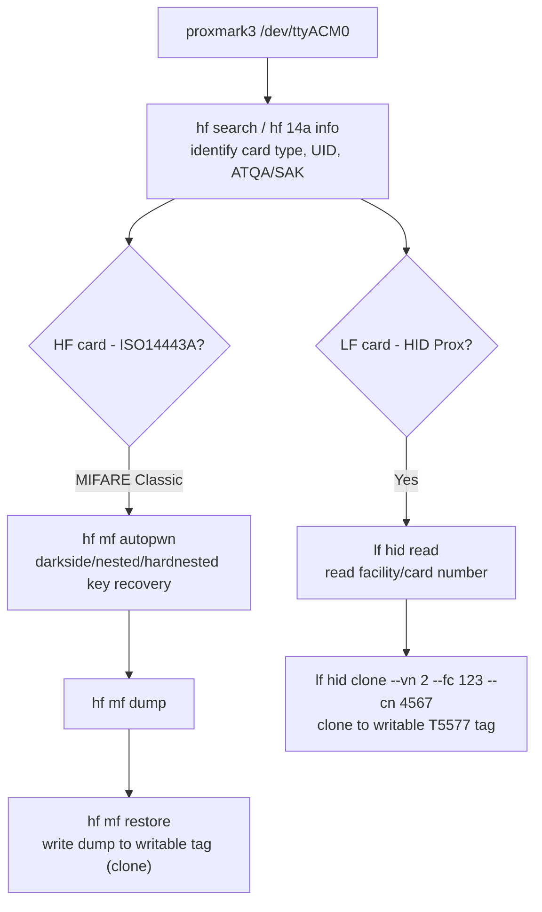

#wireless #bluetooth #ble #rfid #nfc

# Bluetooth (BLE) & RFID/NFC

Related: [tools](../WiFi/tools.md) · [basics](../WiFi/basics.md)

## Contents
- [Classic Bluetooth Discovery](#classic-bluetooth-discovery)
- [BLE (Bluetooth Low Energy) Enumeration](#ble-bluetooth-low-energy-enumeration)
- [Common BLE Weaknesses](#common-ble-weaknesses)
- [RFID / NFC (Proxmark3)](#rfid--nfc-proxmark3)
- [NFC (Android/Phone-Based, No Proxmark)](#nfc-androidphone-based-no-proxmark)

## Classic Bluetooth Discovery
```bash
hcitool scan
hcitool inq
bluetoothctl
```
`hcitool scan` finds nearby discoverable classic-Bluetooth devices; `bluetoothctl` is the modern interactive alternative (`scan on`, `info <mac>`).

## BLE (Bluetooth Low Energy) Enumeration
```bash
hcitool lescan
```
Passive BLE advertisement scan — most IoT/wearables/locks use BLE rather than classic Bluetooth.

```bash
gatttool -b <MAC> --interactive
```
```text
connect
primary
characteristics
char-read-hnd 0x0028
char-write-req 0x002e 0100
```
Connect to a BLE peripheral, list its GATT services (`primary`) and characteristics, then read/write a specific characteristic handle directly — this is how you interact with a BLE lock/sensor without its official app.

```bash
sudo bettercap -iface hci0
```
```text
ble.recon on
ble.show
ble.enum <MAC>
ble.write <MAC> <uuid> <hex-data>
```
Bettercap's BLE module: passive recon, device listing, full GATT enumeration, and writing arbitrary data to a characteristic — useful for replaying/fuzzing BLE lock-unlock or pairing commands.

## Common BLE Weaknesses
| Weakness | Impact |
|---|---|
| No pairing/bonding required to read or write characteristics | Anyone in range can control the device |
| Static/predictable unlock values sent in plaintext over a writable characteristic | Sniff once, replay forever |
| Firmware/version strings exposed in the Device Information service | Fingerprints known CVEs |
| No encryption on the GATT link (Security Mode 1 Level 1) | Despite the device supporting better modes |

## RFID / NFC (Proxmark3)



```bash
proxmark3 /dev/ttyACM0
```
```text
hf search
hf 14a info
```
Identify what's in front of the antenna — card type, UID, ATQA/SAK (ISO14443A, the basis of most access-control and payment cards).

```text
lf hid read
lf hid clone --vn 2 --fc 123 --cn 4567
```
Read a low-frequency HID Prox card's facility/card number, then clone it to a writable T5577 tag.

```text
hf mf autopwn
```
Automated MIFARE Classic attack chain (darkside/nested/hardnested key recovery depending on what the card's firmware allows) — recovers sector keys and dumps the card if any known-weak-key or nonce-reuse condition applies.

```text
hf mf dump
hf mf restore
```
Dump a MIFARE Classic card to a binary file once keys are recovered, or write a crafted dump back to a writable tag (cloning).

## NFC (Android/Phone-Based, No Proxmark)
```bash
nfc-list
nfc-poll
```
`libnfc`'s basic tools for reading tag UID/type from a USB NFC reader when a Proxmark isn't available — sufficient for low-security UID-only access control (common and frequently exploitable, since the UID alone is often the entire check).
